# ISoT — Infrastructure Source of Truth

Inventario de infraestructura con enfoque **Git-as-a-Database**: el estado se
declara en YAML/JSON versionados, sin base de datos ni DCIM físico. El
repositorio modela **varios sitios lógicos** (datacenters) y un catálogo de
cluster-templates compartido. Los datos de ejemplo son ficticios y
anonimizados (SITE1 / SITE2, rangos RFC1918 y de documentación).

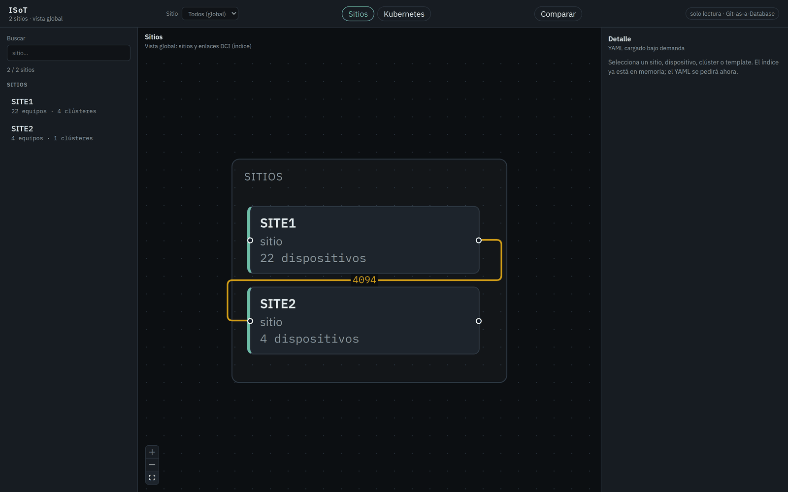

*Vista global: dos sitios de ejemplo unidos por el enlace DCI (VLAN 4094).*

## Arquitectura

```
.
├── sites.yaml                          # Catálogo de sitios y address_spaces
├── sites/
│   ├── _sites_index.json               # Índice global de sitios
│   ├── site1/                          # nube privada de ejemplo
│   │   ├── topology/index.yaml
│   │   ├── clusters/ + _cluster_index.json
│   │   └── devices/  + _device_index.json
│   └── site2/                          # Sitio edge de ejemplo
│       └── cluster-templates/          # Templates solo de este sitio
├── cluster-templates/<nombre>/         # Templates globales (compartidos)
│   ├── template.yaml                   # distro, CNI, node pools, charts[]
│   ├── values/<release>.yaml           # Helm values (lazy-load)
│   └── _template_index.json            # (en cluster-templates/)
├── isot/                               # Validador, indexer, leakcheck, API
└── web/                                # SPA React (Vite + TypeScript)
```

Tres patrones:

1. **Índices ligeros.** La UI lee `_sites_index.json` y los índices por
   sitio. No parsea todos los YAML al arrancar.
2. **Carga perezosa.** El YAML de un dispositivo, clúster o template se abre
   al seleccionarlo. Los values de un Helm chart se leen al expandir el
   chart (`values_ref` → `values/<release>.yaml` o `values_inline`).
3. **Integridad en CI.** El validador rechaza IPs duplicadas **dentro de un
   sitio** y entre sitios que comparten un `address_space`, más
   `cluster_ref` / `template_ref` / `connected_to` rotos, `values_ref`
   inexistentes o YAML inválido, y `values_overrides` que apuntan a un
   release que el template no declara. El motor de reglas (`isot/rules/`)
   añade hallazgos de Kubernetes y de integridad (ver
   [Reglas de control](#reglas-de-control)). `isot-leakcheck` cubre también los
   archivos de values.

Punteros lógicos (se resuelven **en el sitio actual** salvo que se indique otro):

- `cluster_ref: site1-apps` → `sites/site1/clusters/site1-apps.yaml`
- `template_ref: rke2-rancher-hybrid-calico` → `cluster-templates/<nombre>/template.yaml` (o el del sitio)
- `charts[].values_ref` → relativo a la carpeta del template (p.ej. `values/rke2-rancher-hybrid-calico.yaml`)
- `values_overrides[].release` → un `charts[].name` del template
- `connected_to: {device: SITE2-DCGW001, site: site2}` → hostname en ese sitio

Campos vacíos (`""`, `[]`, `null`) son **desconocidos**. No se rellenan.

La UI es **de solo lectura** por defecto. Git es la fuente de verdad; la
edición guiada se activa aparte (ver [Edición con wizards](#edición-con-wizards)).

### Stack

FastAPI + Vite/React/TypeScript + React Flow. El arranque pide
`/api/sites`, índices por sitio, `/api/templates` y `/api/graph`.

## Inventario de ejemplo

Dos sitios ficticios. SITE1 reutiliza una topología de nube privada (VLANs
2000–2011, RKE2, Calico, Multus, MetalLB, Ceph). SITE2 es un edge reducido
que **comparte** el template `rke2-rancher-hybrid-calico` y un enlace DCI
(`192.0.2.0/24`, VLAN 4094, address_space `dci-overlay`). Las VLANs 2002/2003
se repiten en ambos sitios con CIDR distintos: no colisionan.

MGMT001 de SITE1 es un switch de gestión genérico (`vendor: generic`,
`model: mgmt-48x1g`, `os: nos`); el resto de switches son `leaf-32x100g`
con NOS genérico. Los servidores usan `compute-2u` o `compute-12x25g`.

| Sitio | Clúster | Kind | Template | Nodos |
| --- | --- | --- | --- | --- |
| site1 | site1-platform | kubernetes | ninguno (RKE2 custom) | CTRL001-003 |
| site1 | site1-manager | kubernetes | ninguno (kubespray) | mgrvm001-003 |
| site1 | site1-apps | kubernetes | rke2-rancher-hybrid-calico | appvm001-003, NODE002, NODE007 |
| site1 | ceph-site1 | ceph | — | STOR001-002 |
| site2 | site2-edge | kubernetes | rke2-rancher-hybrid-calico | CTRL001-002 |

Templates globales no usados: `rke2-openstack-calico`, `rke2-openstack-cilium`,
`hosted-controlplane-baremetal` (`charts: []`, ningún release documentado). SITE2
tiene además `rke2-edge-calico` (local, sin uso; solo `metallb` enabled).

El template `rke2-rancher-hybrid-calico` declara los Helm charts que ya
estaban en `addons_default` (más el chart umbral del catálogo). Las claves
de `others_keys` aparecen como charts con versión/repo/values **faltantes**.
No se copian `apps_live` del clúster al template: eso es estado observado.

`site1-apps` sobrescribe el chart umbral (`values_overrides`, antes
`values_summary`). `site2-edge` solo sobrescribe los CIDRs documentados
(`10.44.0.0/16` / `10.45.0.0/16`).

Los nombres de host, VLAN y clúster son genéricos (`SITE1-CTRL*`,
`site1-platform`, `site1-apps`, `APP_CTRL` / `APP_DATA`). Quedan a
propósito la marca del proyecto (**ISoT / Infrastructure Source of Truth**),
el campo YAML `infra:` / `infra_range` (notas de plataforma, no un hostname)
e «infraestructura» en español.

La UI, en la vista Kubernetes: **Explorador** (grafo + árbol del template,
values al expandir un chart, búsqueda por ruta tipo `cniConfig.podCIDR`) y
**Diff values** (heredado / sobrescrito / efectivo, con colores). Desde un
clúster se salta a su template y viceversa.

El modo **Comparar** elige dos refs de git y pinta el grafo (verde agregado,
rojo quitado, amarillo modificado, gris sin cambios) más el diff de values
Helm. Un sitio, clúster, template o release **hereda** el estado de sus hijos:
queda amarillo con un badge `+N −N ~N` y el panel lista las entidades
cambiadas (con enlace). Clic o doble clic en un sitio modificado abre ese
sitio sin salir de Comparar. VLANs, devices, enlaces y releases quitados se
dibujan como fantasma (borde rojo punteado). La lista lateral ordena primero
lo cambiado y activa **solo cambios** cuando hay diferencias. Cada lado
permite: (1) rama o tag, (2) un commit del historial reciente de esa rama
(SHA corto, mensaje, autor, fecha, con búsqueda) y (3) pegar un SHA o una
expresión (`HEAD~3`, `main~1`). Comparar dos commits de la misma rama es
válido. El backend resuelve cada ref con `git rev-parse --verify` y
devuelve el SHA en `base.sha` / `head.sha`. Lee los árboles con `git archive`
(sin checkout).

Demo con cambios ficticios (`demo/diff-example` vs el tip de esta rama):

```bash
# Comparar → Base HEAD de esta rama → Head demo/diff-example
# VLAN 2099 LAB / LAB_NET, se quita site1-jump001, cniConfig.mtu 1440 → 1500
```

## Detalle de conexiones

Toda línea de los grafos (Red, Kubernetes, mapa global con DCI, Comparar y la
vista previa del wizard) es clicable: tiene un área de clic más ancha, se
resalta al pasar el mouse y, al pincharla, resalta la conexión y sus dos
extremos (atenúa el resto). El panel **Detalle** muestra la vista
**Conexión**:

- extremos (equipo, rol, clúster), clicables para enfocar cada uno;
- un bloque por enlace lógico (bond, interfaz, OOB, hypervisor o DCI) con, por
  lado, interfaz/puerto, bond, PortChannel/LAG, LACP (`mode`), miembros, IP y
  MTU; VLANs con nombre, red, gateway y VRF; y la ruta YAML (archivo + clave)
  con el fragmento plegable. Lo que el inventario no declara se muestra como «—»;
- en Comparar, el estado de la arista en el diff y los cambios de atributos;
- hallazgos relacionados (p.ej. `INV-PORT`).

`Esc` o un clic en el fondo limpia la selección. API:
`GET /api/link?source=<id>&target=<id>[&base=<ref>&head=<ref>]` y
`POST /api/link/preview` (con los archivos de la vista previa del wizard).

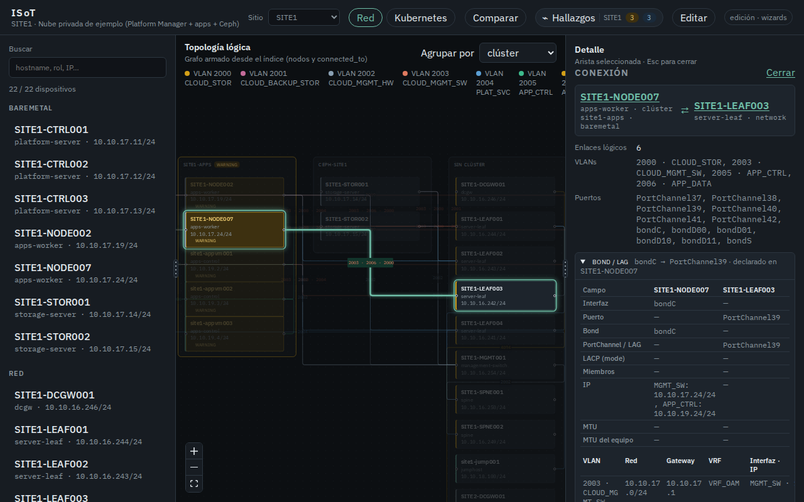

## Edición con wizards

La UI no escribe YAML hasta que confirmas. Para encender los wizards:

```bash
ISOT_EDIT=1 ./scripts/serve.sh --edit
```

Aparece el botón **Editar** (ausente en solo lectura). Es un toggle: entra al
wizard y, si ya estás ahí, vuelve a Sitios / Kubernetes / Comparar **con el
mismo sitio**.

### Flujo Git

El preview corre en memoria (nada se escribe). **Confirmar** crea una rama
`wizard/<descripcion>` desde HEAD, escribe YAML + índices, corre el validador
y hace commit. Si el validador falla: `git reset --hard`, se borra la rama y
no queda rastro. Nunca escribe en `main` ni en la rama de trabajo. Después
abre **Comparar** con base = la rama actual y head = `wizard/…` (verde
agregado, amarillo afectado).

### Autoasignación por rol

Hostname, IPs y PortChannel salen de hermanos del **mismo rol y tipo**, no
del clúster a secas. Orden: mismo rol en el clúster → mismo rol en el sitio →
patrón de otro sitio o convenio (`apps-worker`/`worker` → `NODE`,
`edge-server`/`platform-server` → `CTRL`, storage → `STOR`, leaf → `LEAF`,
spine → `SPNE`, mgmt → `MGMT`, dcgw → `DCGW`). Nunca reutiliza el prefijo de
otro rol. El número es el hueco más bajo de ese prefijo (SITE1-NODE003 si
faltaba el 3). Specs (bonds, VLANs) vienen de `connection_rules` o del
device más parecido **sin** copiar hostname ni rol. Si no hay hermanos, la UI
avisa **sin hermanos del mismo rol: patrón nuevo**.

### connection_rules

**Nuevo sitio** empieza por la arquitectura (Spine-Leaf, collapsed core o
personalizada) y sigue con las reglas de conexión, persistidas en
`sites/<id>/topology/index.yaml` como `connection_rules`: dual-home a un par
de leafs, uplinks a spines, bond de storage, OOB al MGMT, política fill-first
o round-robin. El generador y **Agregar device** las respetan. En sitios
viejos sin el bloque se infieren de los hermanos y se pueden guardar. El
validador avisa (`[WARN]`, no error) si un device las viola.

### Paneles redimensionables

Todos los límites entre paneles se arrastran con el mouse: menú lateral,
detalle, hallazgos, Campos/YAML del wizard, alto del grafo del explorador
(y del grafo frente al detalle en pantallas angostas), lista ↔ chart del
explorador y Base ↔ Head en «lado a lado». El divisor se resalta al pasar
el mouse (cursor ↔ / ↕, grip con puntos). Con foco: flechas (Shift = paso
largo), Home/End y Enter (colapsa/expande menú y detalle). Doble clic
restablece el tamaño por defecto; arrastrar el menú o el detalle bajo la
mitad de su mínimo los colapsa. Los tamaños se guardan por vista en
`localStorage` (`isot.layout.v1`) y los grafos se reencuadran al soltar.

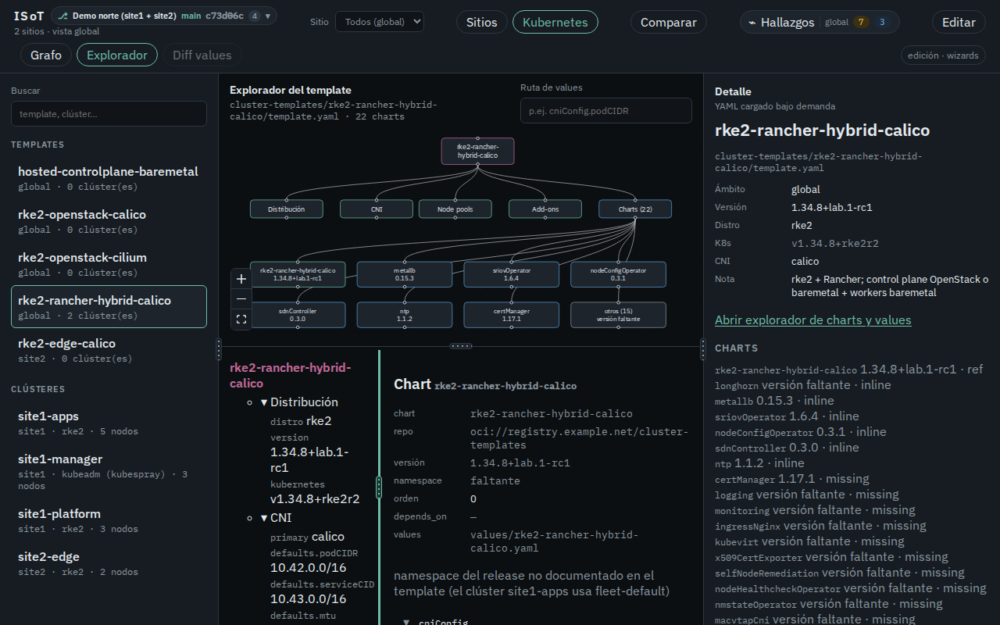

*Explorador de un template a 1280×800: divisor grafo/lista en pleno arrastre
(resaltado) y grips en el menú, la lista y el panel de hallazgos.*

### Layout del wizard

La página del wizard ocupa el viewport y scrollea entera si es corto. El
grafo y el panel **Campos / YAML** scrollean cada uno por su cuenta, así que
el panel siempre se alcanza. **Ocultar grafo** / **Mostrar grafo** deja el
panel a todo el ancho; el divisor entre ambos se arrastra (o ← → con foco).
Hallazgos y corrección van en una barra de estado de una línea (clic en
**detalles** para desplegar) y «Acepto N aviso(s) nuevo(s)» queda junto a
Confirmar. Grafo oculto y ancho del panel se guardan con el borrador.

### Borrador persistente

Wizard activo, paso, campos, reglas y preview viven en el estado de la app y
en `sessionStorage` (`isot.wizard.session`). Cambiar de pestaña o recargar no
tira el avance. Un badge **borrador** en Editar indica que hay un wizard en
curso; **Descartar borrador** pide confirmación. Un commit exitoso limpia el
borrador.

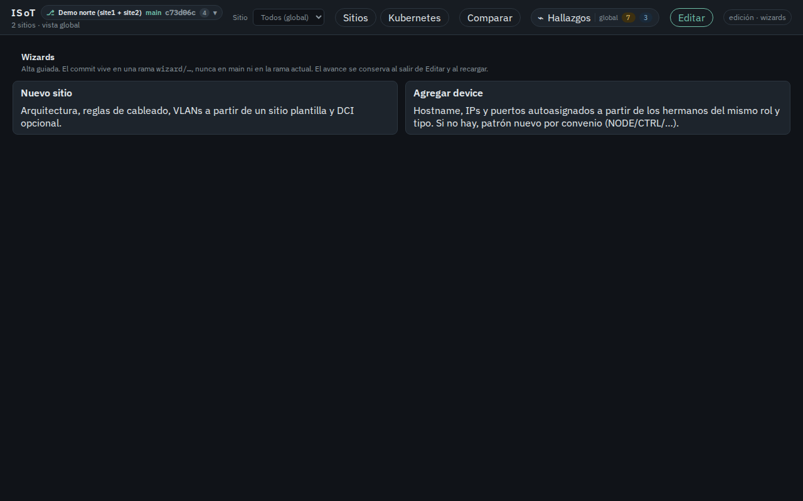

*Inicio del wizard: **Nuevo sitio** o **Agregar device**. Editar queda activo.*

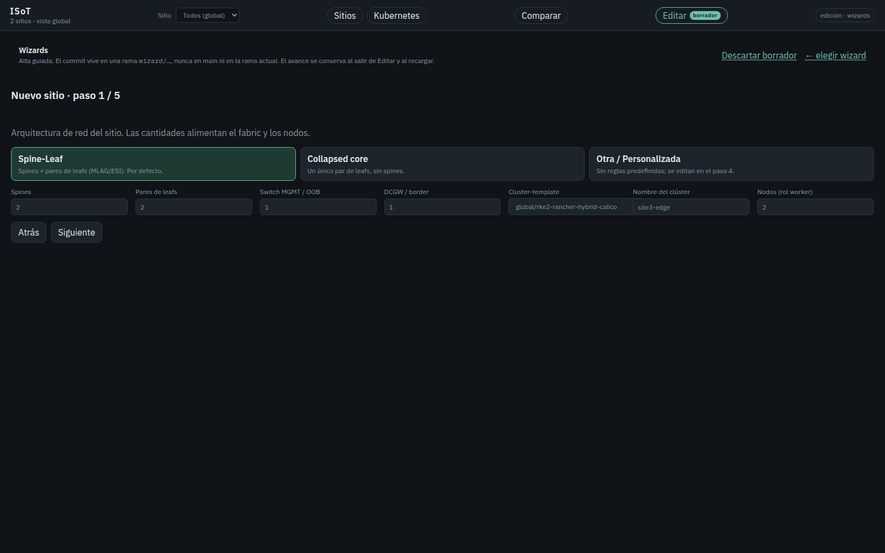

*Nuevo sitio, paso 1/5 **Arquitectura**: Spine-Leaf por defecto, cantidades de
spines, pares de leafs, MGMT, DCGW y nodos por rol.*

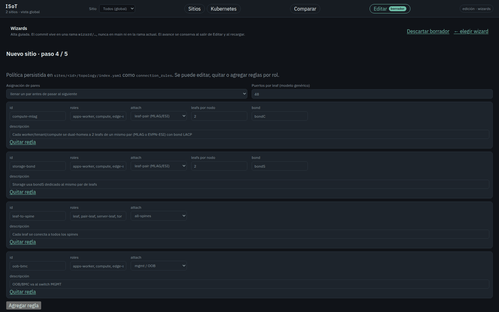

*Paso 4/5: política fill-first / round-robin y reglas editables (compute-mlag,
storage-bond, leaf-to-spine, oob-bmc). Se guardan como `connection_rules`.*

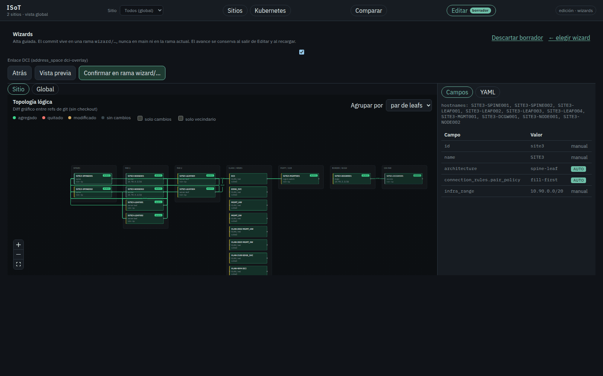

*Vista previa de un sitio spine-leaf (SITE3): capa de spines, pares de leafs y
workers, agrupado por par. Nada se escribe hasta Confirmar.*

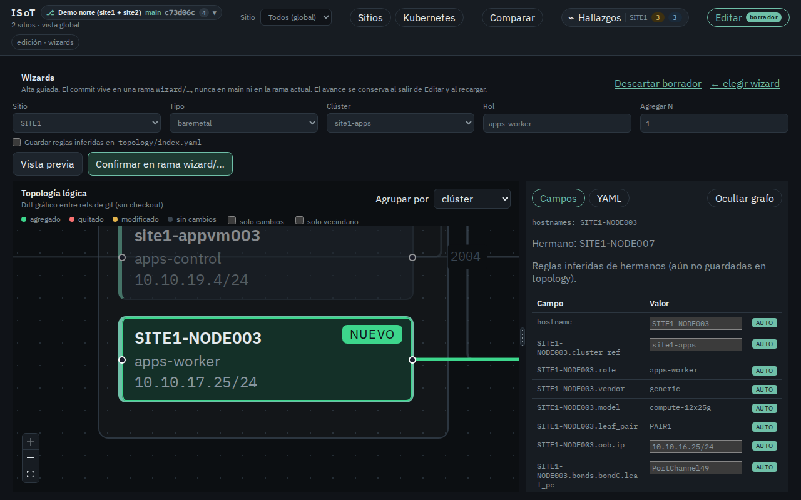

*Worker de `site1-apps`: el grafo enfoca `SITE1-NODE003` (badge **nuevo**),
hermano `SITE1-NODE007`, campos marcados **auto**.*

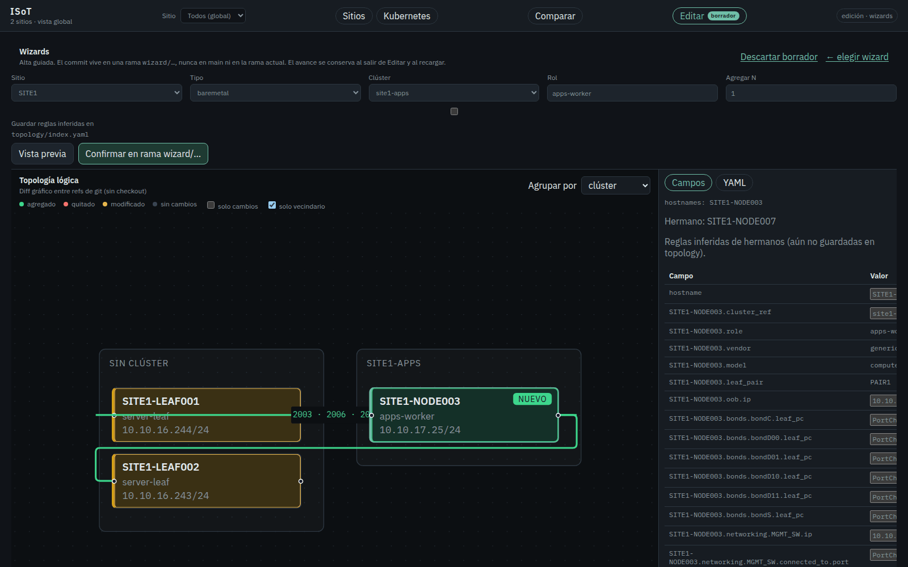

*Toggle **solo vecindario**: el worker nuevo y los leafs del par (amarillo), a
un salto.*

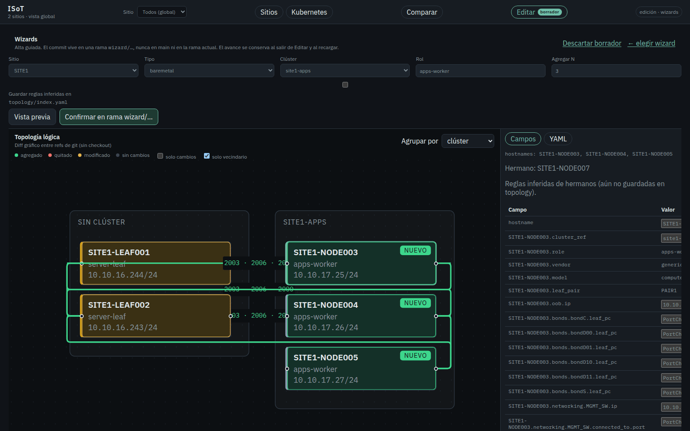

*Agregar N=3 en `site1-apps`: `SITE1-NODE003`, `NODE004` y `NODE005` en verde,
conectados al par de leafs.*

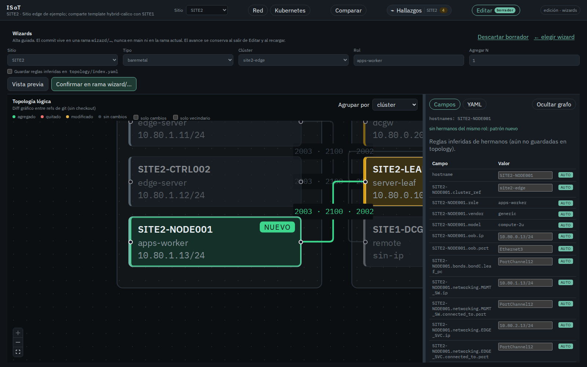

*SITE2, clúster `site2-edge`, rol `apps-worker` (sin hermanos): hostname
`SITE2-NODE001`, no un `CTRL` de `edge-server`. Nota **sin hermanos del mismo
rol: patrón nuevo**.*

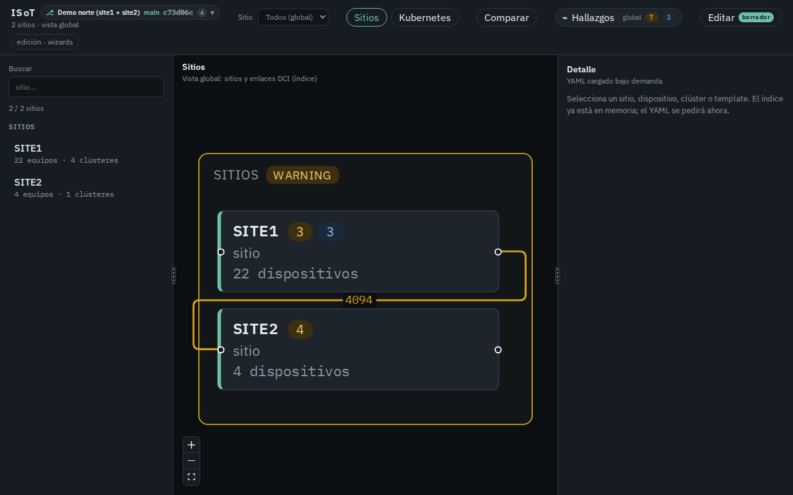

*Tras avanzar el wizard y volver a Sitios: **Editar** lleva el badge
**borrador**. El grafo global no pierde el sitio.*

## Reglas de control

Catálogo versionado en [`docs/rules.md`](docs/rules.md) e
`isot/rules/k8s_eol.yaml` (EOL de Kubernetes, fácil de actualizar). Cada
regla tiene id estable (`K8S-CP-001`, `INV-IP-001`, …), severidad por
defecto y recomendación.

Los hallazgos son **por sitio**. Dentro de un sitio (Red, Kubernetes,
values o el wizard de ese sitio) la campana del header y el panel muestran
solo los hallazgos de ese sitio, con contadores error / warning / info. Un
hallazgo de un template global aparece en un sitio solo si alguno de sus
clústeres usa ese template, marcado como «plantilla … · vía clúster …» y
atribuido a ese clúster. En la vista global (mapa de sitios) el panel
agrupa por sitio con contadores por grupo, más un grupo «Global /
plantillas» para templates que ningún clúster usa; cada nodo de sitio del
mapa lleva sus propios contadores, y un clic en el grupo o en el nodo abre
el sitio. El panel filtra por severidad, clúster y regla; cada hallazgo
enlaza a la entidad (foco en el grafo) y enseña la recomendación. Los
nodos y grupos de clúster llevan badge de severidad. En wizards, la vista
previa evalúa el estado propuesto: **solo los errores nuevos del sitio del
wizard bloquean Confirmar** (los de otros sitios no); warnings nuevos
piden un checkbox. Comparar lista hallazgos añadidos y resueltos entre
base y head, también acotado al sitio elegido.

Silencio: `rule_overrides: [{id: K8S-CP-001, severity: off, reason: "..."}]`
en el YAML del clúster, device o `topology/index.yaml`. Sin `reason` el
override se ignora (`RULE-OVR-001`).

```bash
python -m isot.validator              # exit ≠ 0 solo con errores
python -m isot.validator --strict     # también falla por warnings
python -m isot.validator --format json
```

En GitHub Actions el validador emite annotations para avisos e infos.

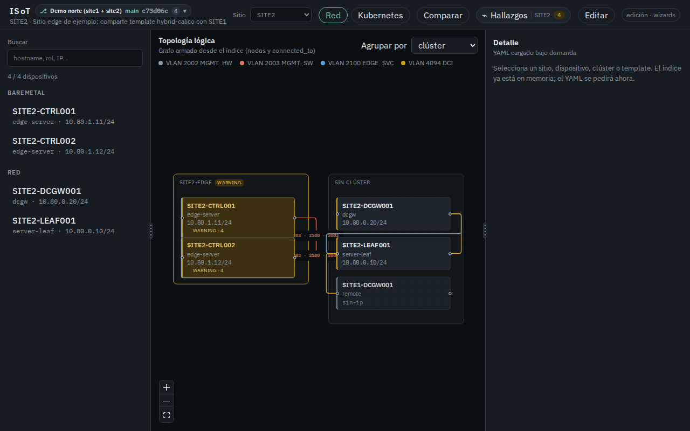

*Header dentro de un sitio: la campana cuenta solo los hallazgos de ese sitio.*

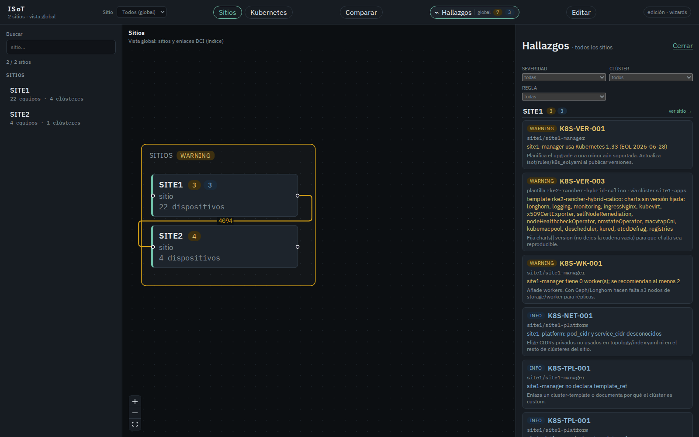

*Vista global: panel agrupado por sitio (con «Global / plantillas» aparte) y
contadores en cada nodo de sitio; clic en un grupo abre el sitio.*

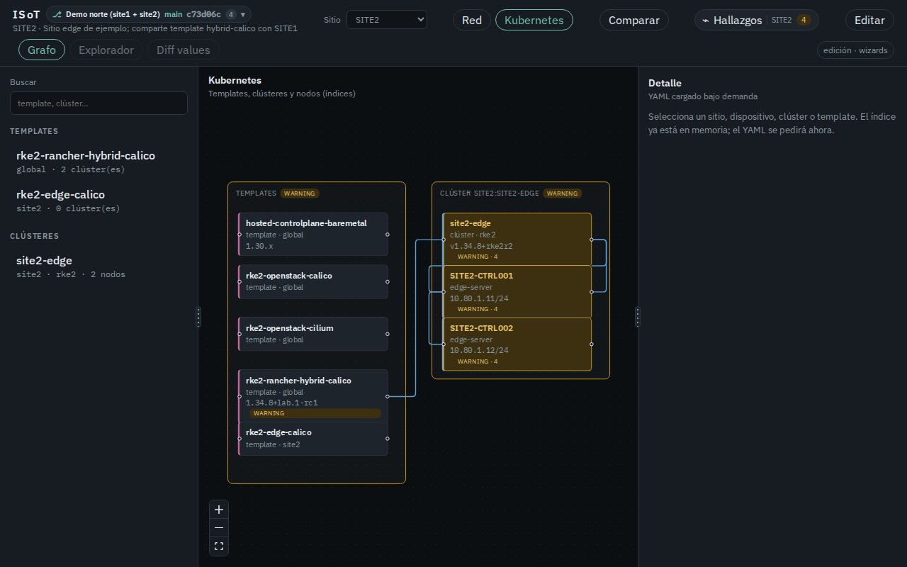

*Clústeres Kubernetes con badge warning/info sobre el nodo y el grupo.*

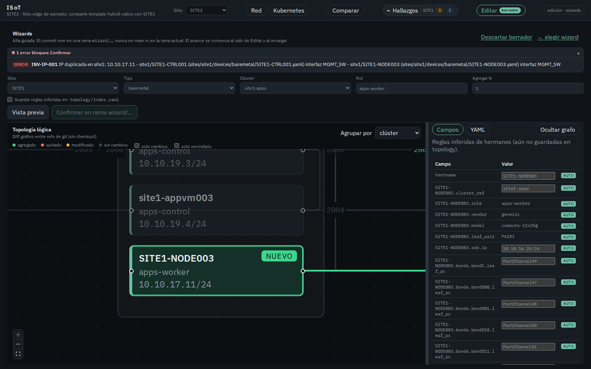

*Vista previa del wizard: un error nuevo deshabilita Confirmar; la barra de
estado desplegada muestra el detalle.*

**Corregir desde un hallazgo.** Los hallazgos que se arreglan agregando
componentes (K8S-CP-001, K8S-WK-001, K8S-ST-001, y un leaf para
K8S-CP-002) traen **Corregir** en el panel: abre Editar con el wizard
«Agregar device» precargado (sitio, clúster, rol del clúster y cantidad
que falta) y la vista previa dice si el cambio **resuelve** el hallazgo.
El resto trae **Abrir …** (clúster, template o values). Sin modo edición
el botón queda deshabilitado. Detalle en
[`docs/rules.md`](docs/rules.md#remediación).

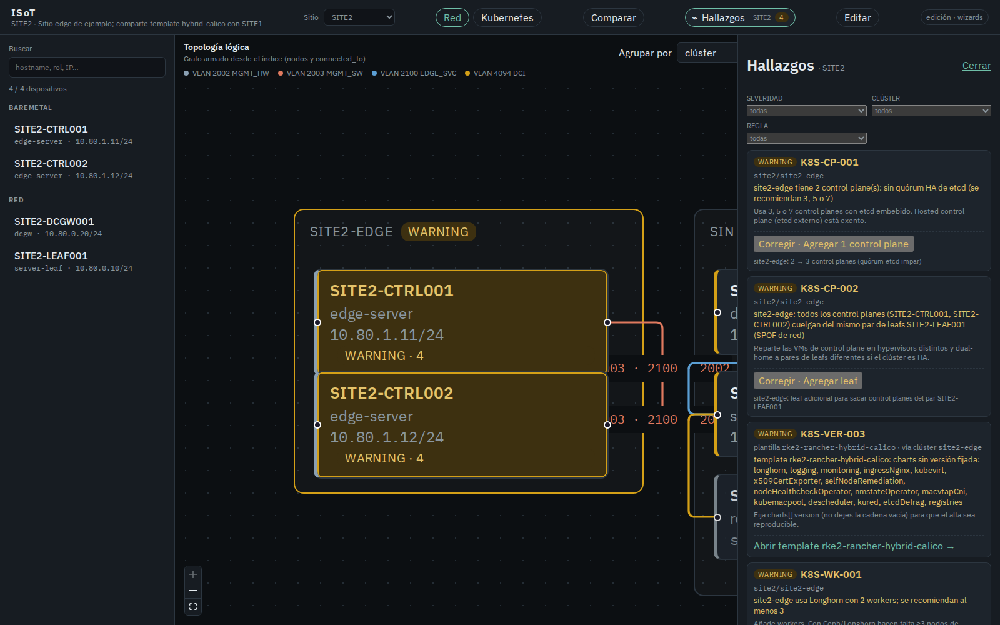

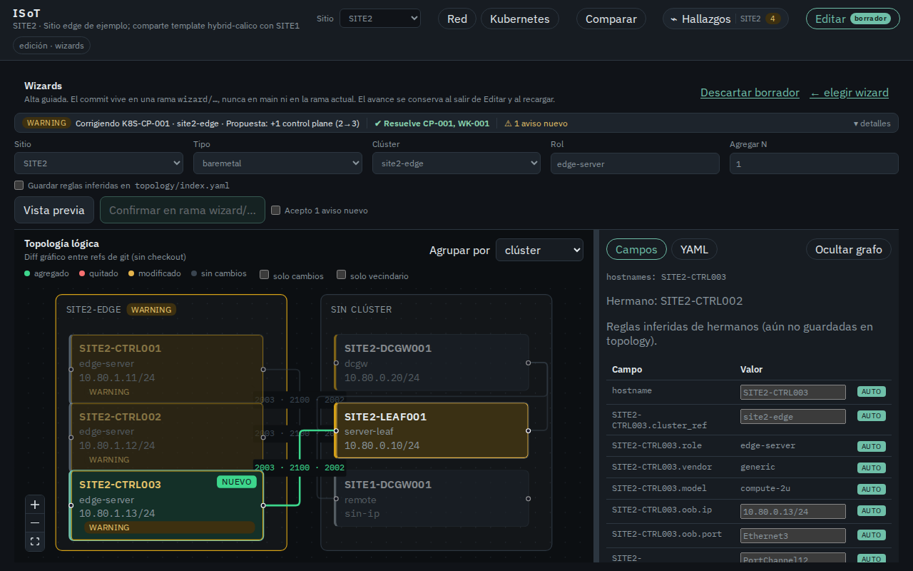

*Corregir K8S-CP-001 en site2-edge (1280×800): propone SITE2-CTRL003
(verde) con la siguiente IP y PortChannel en SITE2-LEAF001. Una sola barra
de estado: «Corrigiendo K8S-CP-001 · site2-edge · Propuesta: +1 control
plane (2→3) | ✔ Resuelve CP-001, WK-001 | ⚠ 1 aviso nuevo».*

## Capturas

### Topología de SITE1

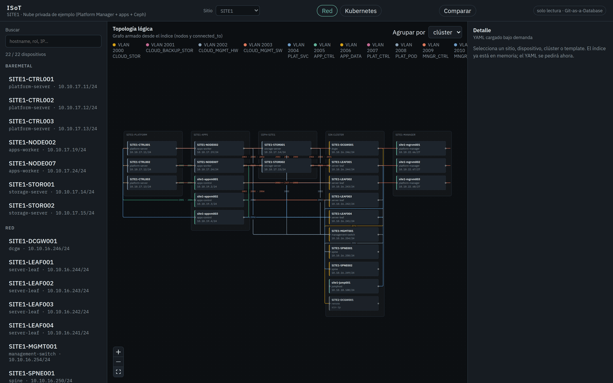

Grafo de dispositivos, VLANs y `connected_to` del sitio de nube privada.

### Kubernetes

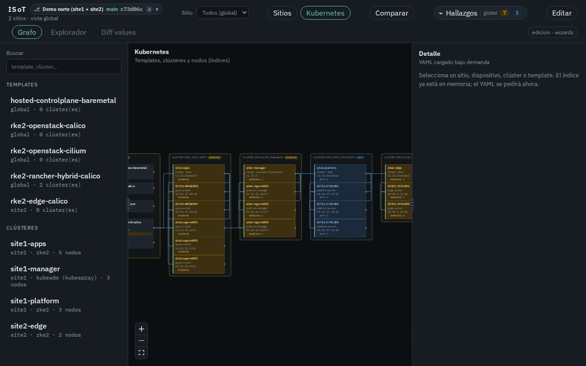

Templates globales y de sitio, clústeres y nodos a partir de los índices.

### Explorador de template

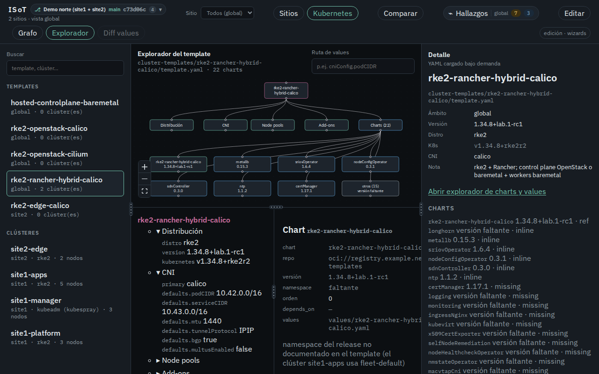

Árbol de un template con búsqueda por ruta (`cniConfig.mtu`) y values cargados al expandir el chart.

### Diff de values

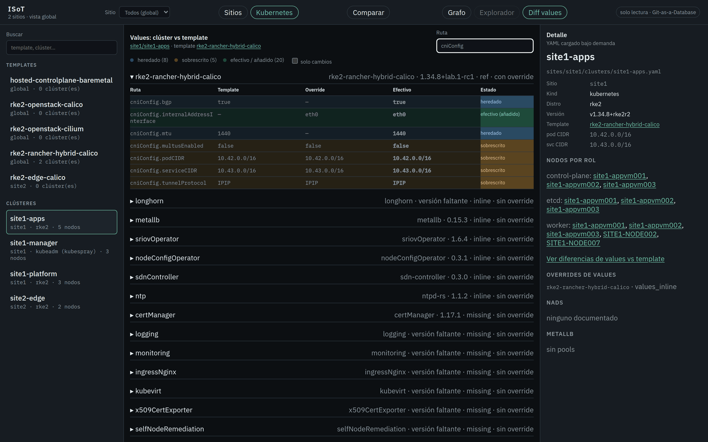

Clúster vs template: heredado, sobrescrito y efectivo, filtrado por `cniConfig`.

### Comparar (grafo)

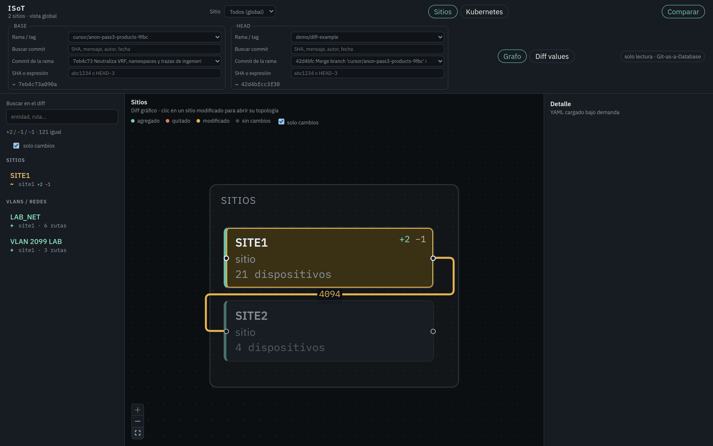

Diff gráfico entre el tip de esta rama y `demo/diff-example`: SITE1 en amarillo con badge `+2 −1`.

### Comparar (values)

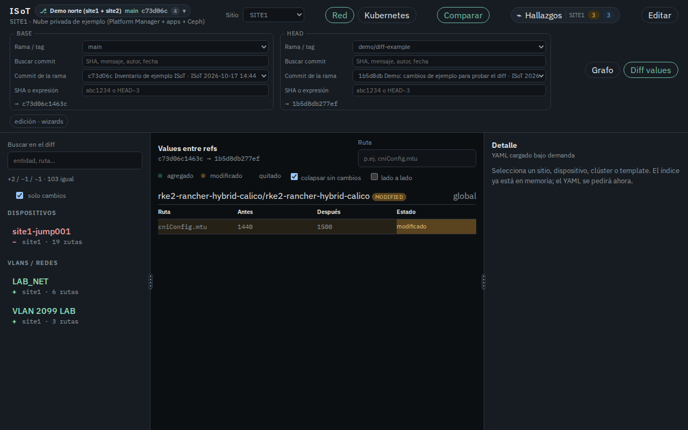

`cniConfig.mtu` lado a lado: 1440 en la base, 1500 en el head de ejemplo.

## Cómo usarlo

```bash
./scripts/serve.sh          # http://localhost:8000  (solo lectura)
ISOT_EDIT=1 ./scripts/serve.sh --edit
# o: docker compose up --build
```

Desarrollo: `./scripts/dev.sh` (API :8000, Vite :5173).

```bash
python -m isot.validator
python -m isot.indexer          # sitios + devices + clusters + templates
python -m isot.indexer --check
python -m isot.leakcheck
pytest
cd web && npm ci && npm test && npm run build
```

API de solo lectura: `/api/sites`, `/api/sites/{id}/devices`,
`/api/sites/{id}/clusters`, `/api/sites/{id}/graph?view=network|kubernetes`,
`/api/graph?view=global`, `/api/templates`, detalle bajo demanda,
`/api/templates/{name}/values/{release}` (lazy),
`/api/sites/{id}/clusters/{name}/values-diff`,
`/api/refs`, `/api/commits?rev=<ref>`, y
`/api/diff?base=<ref>&head=<ref>[&site=<id>]`,
`/api/findings?site=&ref=` (estricto por sitio; sin `site` trae `by_site`
y `global`), `/api/findings?base=&head=[&site=]`, `/api/rules`,
`/api/link?source=&target=[&base=&head=]`.
Con edición: `GET /api/wizard/status`, `GET /api/wizard/cabling-defaults`,
`POST /api/wizard/device/preview|commit`, `POST /api/wizard/site/preview|commit`.

Convenciones para agentes: [LLM_INSTRUCTIONS.md](LLM_INSTRUCTIONS.md).
