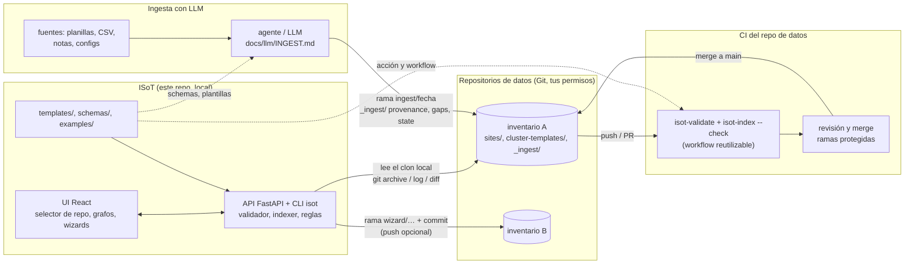
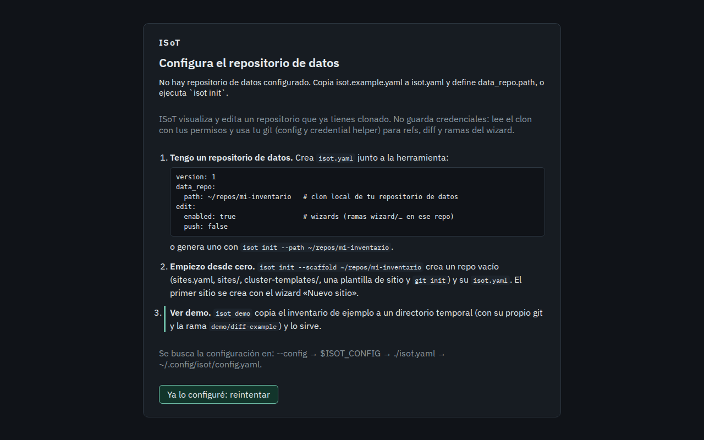
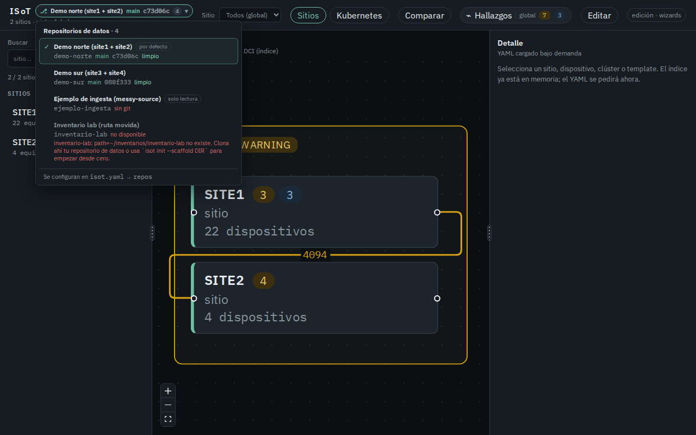
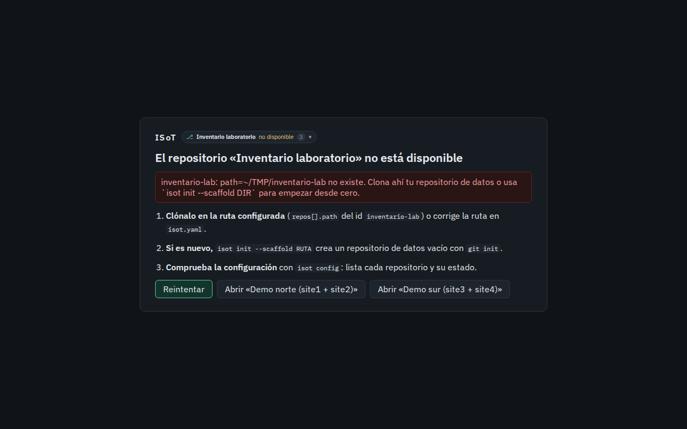
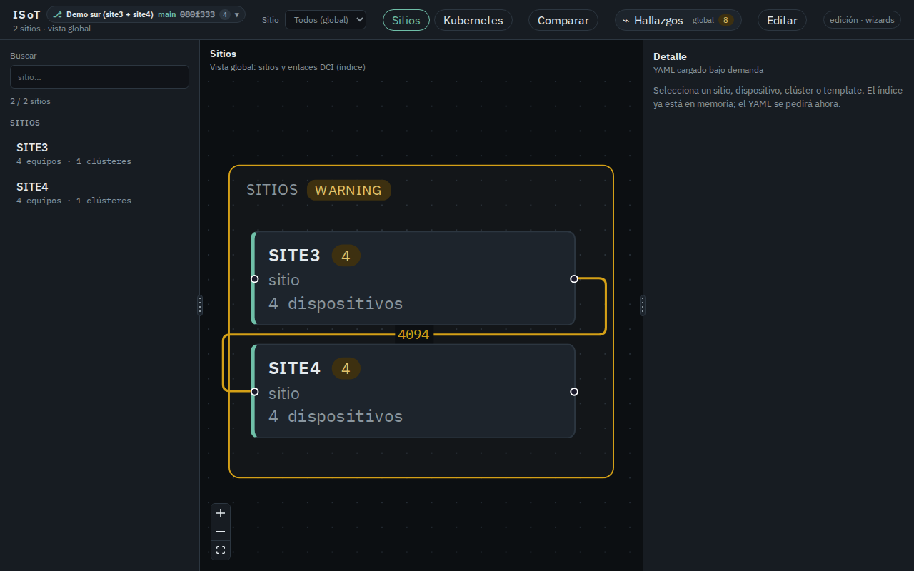
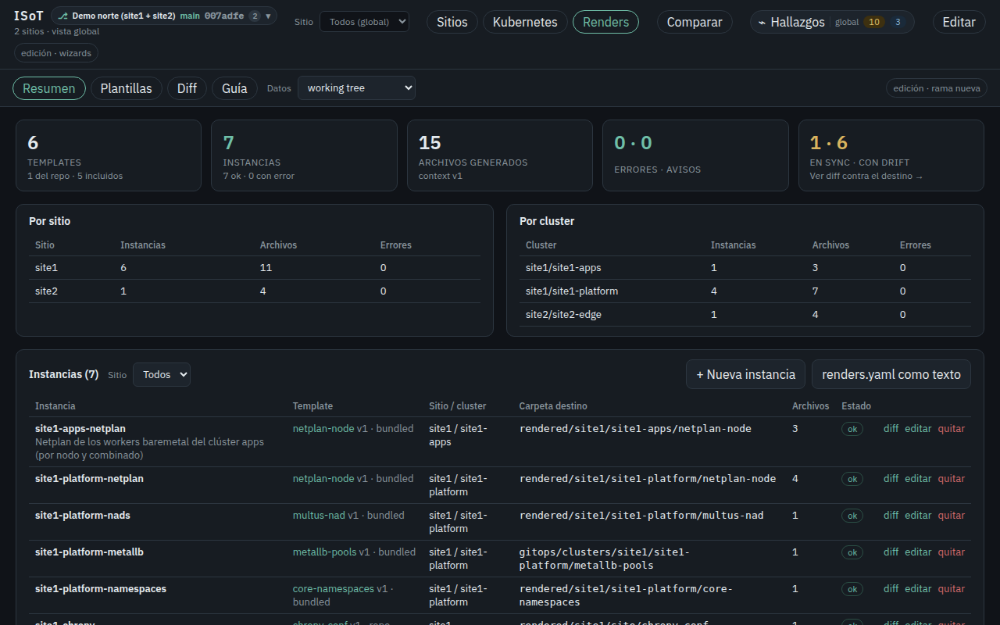
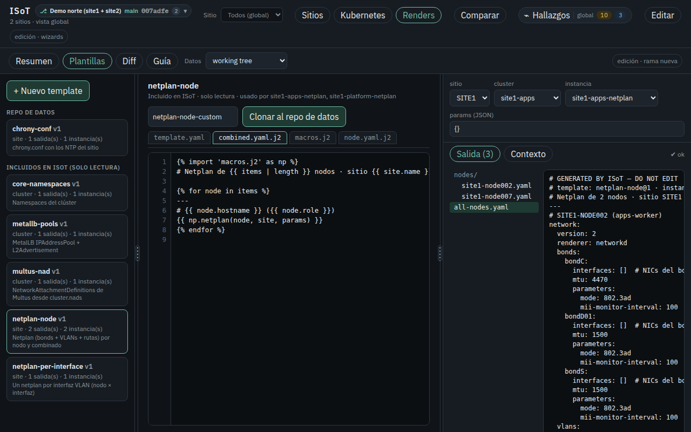
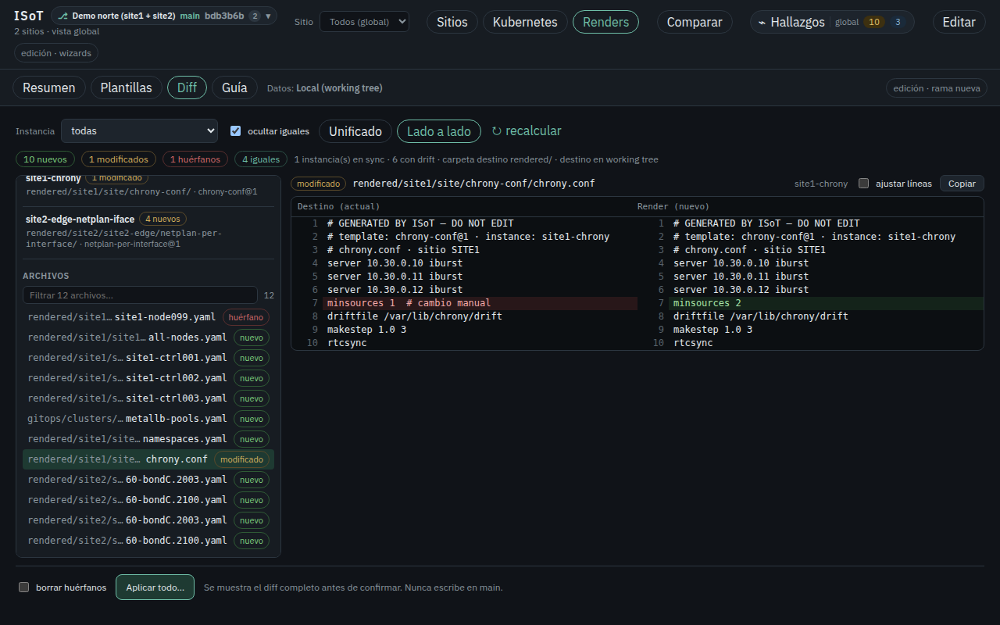
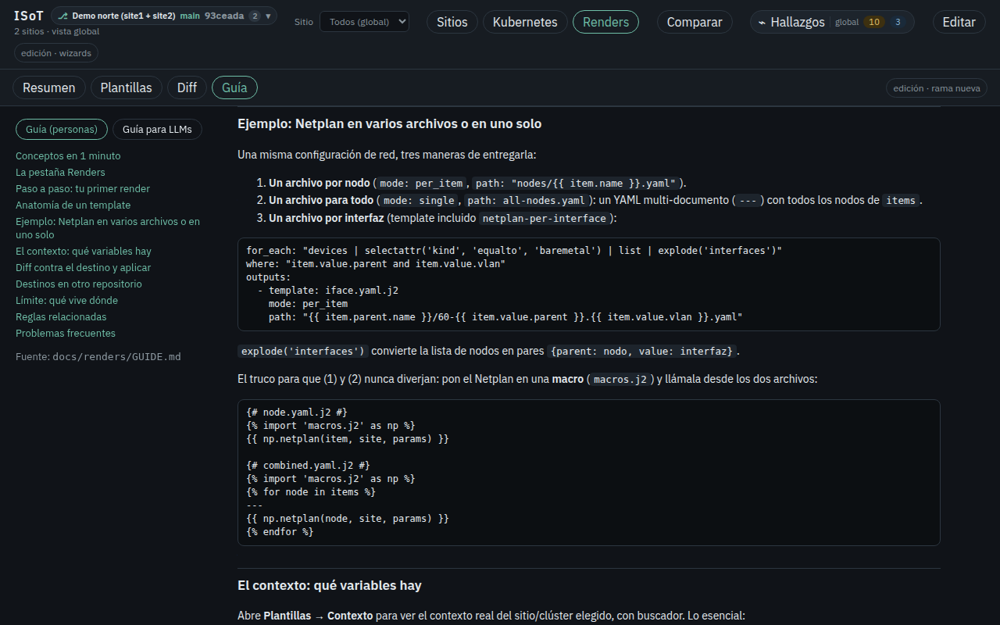
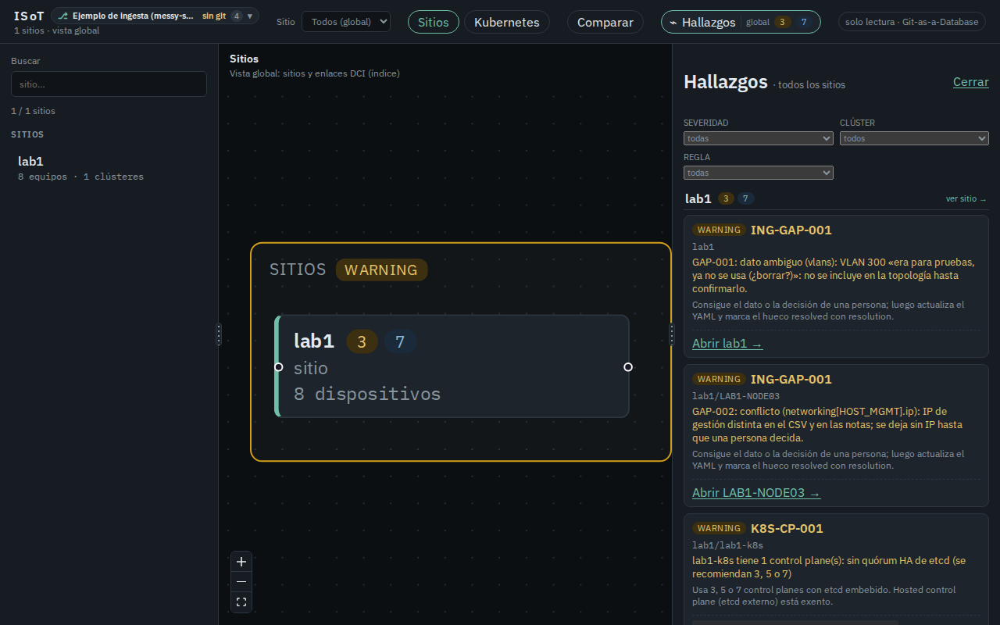

# ISoT — Infrastructure Source of Truth

ISoT es un **visualizador y editor local** de uno o varios **repositorios
Git de datos de infraestructura** a los que ya tienes acceso. El inventario
(sitios, topología, dispositivos, clústeres Kubernetes, cluster-templates y
values de Helm) vive en YAML/JSON versionados en *esos* repositorios, con
enfoque **Git-as-a-Database**: sin base de datos ni DCIM. ISoT los lee desde
tu clon local, los dibuja, los valida y propone cambios en ramas `wizard/…`.


*Vista global de `demo-norte` (SITE1 y SITE2 unidos por el enlace DCI). La
insignia de la cabecera es el selector de repositorio de datos: nombre, rama
y HEAD corto.*

## Qué es

- **Una herramienta local.** Corre en tu máquina (`127.0.0.1` por defecto),
  apunta a clones que ya tienes y trabaja con tus permisos de git.
- **Multi-repositorio.** Un `isot.yaml` lista uno o varios repositorios de
  datos (p.ej. uno por región o por equipo) y la cabecera cambia entre
  ellos; cada repo tiene su propio estado, hallazgos y ramas.
- **Visor + editor.** Mapa global de sitios, red por sitio, Kubernetes,
  explorador de templates y values, Comparar entre Local (working tree), ramas y commits, hallazgos de
  reglas de control y wizards que escriben YAML en una rama nueva.
- **Plantillas y ejemplos, no datos.** Este repositorio trae solo código,
  plantillas (`templates/`), schemas (`schemas/`) y ejemplos ficticios
  (`examples/`). Los datos de ejemplo son anonimizados (SITE1…SITE4, rangos
  RFC1918 y de documentación).
- **Preparado para ingesta con LLM.** Una guía y schemas para que un agente
  construya o actualice un repositorio de datos desde fuentes desordenadas,
  con procedencia, huecos y seguimiento de cambios en `_ingest/`.

## Alcance

| ISoT es | ISoT no es |
| --- | --- |
| Un visor/editor local de repositorios Git de datos que ya tienes clonados | Un inventario: no guarda datos propios ni lee el inventario de su propia carpeta |
| Un cliente de git con **tu** identidad, credential helper y ssh-agent | Un servicio con usuarios, roles o credenciales propias |
| Un generador de propuestas: ramas `wizard/…` que revisas y fusionas en el repo de datos | Quien decide qué entra a `main`: eso lo deciden los permisos, revisiones y CI del repo de datos |
| Un validador (reglas + JSON Schema) que también corre en la CI del repo de datos | Un DCIM, un IPAM con reservas en línea ni una CMDB con descubrimiento |
| Una guía y un formato para ingesta con LLM (`docs/llm/INGEST.md`) | Un LLM: ISoT no llama a modelos; la ingesta la hace tu agente siguiendo la guía |
| Proveedor de plantillas de sitio y cluster-templates de biblioteca | Comparar **entre** repositorios distintos (Comparar trabaja con refs de un mismo repo) |
| Un motor de **renders** (Jinja2 en sandbox) que genera Netplan, manifiestos, etc. y los compara con una carpeta destino | Un sistema de despliegue: ISoT propone ramas con la salida; aplicarla en los equipos es cosa de tu GitOps/CI |

La seguridad y el control de acceso se **delegan en los repositorios de
datos**: quién lee, quién propone y quién aprueba lo deciden sus permisos,
ramas protegidas y CI. Ver [Modelo de seguridad](#modelo-de-seguridad).

## Arquitectura



- **La herramienta** no tiene estado propio: cada repositorio se abre de
  forma perezosa desde su ruta y un cambio en `isot.yaml` se recarga sin
  reiniciar.
- **Los repositorios de datos** son la fuente de verdad. ISoT nunca escribe
  en `main` ni en la rama de trabajo: solo crea ramas `wizard/…`.
- **La CI del repo de datos** corre el mismo validador e indexer
  (workflow reutilizable de este repo), así que las reglas se aplican igual
  en la UI y en el PR.
- **La ingesta con LLM** produce commits en una rama `ingest/<fecha>` del
  repo de datos, con procedencia, huecos y estado en `_ingest/`.

Herramienta (este repositorio: código, plantillas y ejemplos, sin datos reales):

```
.
├── isot/                               # Validador, indexer, leakcheck, API, CLI `isot`
├── web/                                # SPA React (Vite + TypeScript)
├── templates/
│   ├── cluster-templates/<nombre>/     # Biblioteca de cluster-templates (fallback)
│   ├── sites/{edge,cloud}/             # Plantillas de sitio del wizard «Nuevo sitio»
│   └── manifests/<id>/                 # Templates de render genéricos (solo lectura; se clonan al repo de datos)
├── schemas/                            # JSON Schema del formato del repo de datos (generado)
├── examples/
│   ├── demo-repo/                      # Inventario de ejemplo (base de isot demo)
│   └── messy-source/                   # Ejemplo de ingesta: fuentes desordenadas → repo esperado
├── docs/                               # rules.md, renders/GUIDE.md, llm/{INGEST,RENDERS}.md, dev/, images/
├── isot.example.yaml                   # Plantilla de configuración (isot.yaml va en .gitignore)
└── .github/{actions/validate,workflows/validate-data-repo.yml}  # CI para repos de datos
```

Repositorio de datos (uno por inventario, en su propio remoto; `examples/demo-repo/` tiene esta forma):

```
.
├── sites.yaml                          # Catálogo de sitios y address_spaces
├── sites/
│   ├── _sites_index.json               # Índice global de sitios
│   ├── site1/                          # nube privada de ejemplo
│   │   ├── topology/index.yaml
│   │   ├── clusters/ + _cluster_index.json
│   │   └── devices/  + _device_index.json
│   └── site2/                          # Sitio edge de ejemplo
│       └── cluster-templates/          # Templates solo de este sitio
├── cluster-templates/<nombre>/         # Templates globales (compartidos)
│   ├── template.yaml                   # distro, CNI, node pools, charts[]
│   ├── values/<release>.yaml           # Helm values (lazy-load)
│   └── _template_index.json            # (en cluster-templates/)
├── site-templates/<nombre>/            # Opcional: plantillas de sitio propias
├── _ingest/                            # Opcional: state, provenance y gaps de la ingesta con LLM
├── renders.yaml                        # Opcional: instancias de render y su carpeta destino (target_dir)
├── manifest-templates/<id>/            # Opcional: templates de render propios (template.yaml + *.j2)
├── rendered/                           # Opcional: salida aplicada de los renders (mismo repo)
└── .github/workflows/isot-validate.yml # CI con el workflow reutilizable de ISoT
```

Tres patrones:

1. **Índices ligeros.** La UI lee `_sites_index.json` y los índices por
   sitio. No parsea todos los YAML al arrancar.
2. **Carga perezosa.** El YAML de un dispositivo, clúster o template se abre
   al seleccionarlo. Los values de un Helm chart se leen al expandir el
   chart (`values_ref` → `values/<release>.yaml` o `values_inline`).
3. **Integridad en CI.** El validador rechaza IPs duplicadas **dentro de un
   sitio** y entre sitios que comparten un `address_space`, más
   `cluster_ref` / `template_ref` / `connected_to` rotos, `values_ref`
   inexistentes o YAML inválido, y `values_overrides` que apuntan a un
   release que el template no declara. El motor de reglas (`isot/rules/`)
   añade hallazgos de Kubernetes y de integridad (ver
   [Reglas de control](#reglas-de-control-y-hallazgos)). `isot-leakcheck` cubre también los
   archivos de values.

Punteros lógicos (se resuelven **en el sitio actual** salvo que se indique otro):

- `cluster_ref: site1-apps` → `sites/site1/clusters/site1-apps.yaml`
- `template_ref: rke2-rancher-hybrid-calico` → `cluster-templates/<nombre>/template.yaml` (o el del sitio)
- `charts[].values_ref` → relativo a la carpeta del template (p.ej. `values/rke2-rancher-hybrid-calico.yaml`)
- `values_overrides[].release` → un `charts[].name` del template
- `connected_to: {device: SITE2-DCGW001, site: site2}` → hostname en ese sitio

Campos vacíos (`""`, `[]`, `null`) son **desconocidos**. No se rellenan.

La UI es **de solo lectura** por defecto. Git es la fuente de verdad; la
edición guiada se activa aparte (ver [Edición con wizards](#edición-con-wizards)).

### Stack

FastAPI + Vite/React/TypeScript + React Flow. El arranque pide
`/api/sites`, índices por sitio, `/api/templates` y `/api/graph` del
repositorio activo (`/api/repos/{id}/…`).

## Inicio rápido

```bash
pip install -e .                       # en el clon de ISoT (o pipx install .)
```

**1. Probar con dos repos de ejemplo.**

```bash
isot demo --multi                      # crea demo-norte + demo-sur + isot.yaml y lo sirve
isot demo --multi --dir ~/isot-demos --no-serve   # solo prepararlos
isot web --config ~/isot-demos/isot.yaml --edit   # servirlos después
```

`demo-norte` trae site1 + site2 y la rama `demo/diff-example` para
**Comparar**; `demo-sur` trae site3 + site4 (dos sitios edge con DCI). Cada
demo es un repo git propio: los wizards crean ramas ahí, nunca en ISoT.

**2. Ya tengo un repositorio de datos.**

```bash
git clone <url-de-tu-inventario> ~/repos/mi-inventario   # con tus credenciales
isot init --path ~/repos/mi-inventario                    # escribe isot.yaml
./scripts/serve.sh                                        # http://127.0.0.1:8000
```

**3. Empiezo desde cero.**

```bash
isot init --scaffold ~/repos/mi-inventario --edit   # repo vacío + git init + isot.yaml
ISOT_EDIT=1 ./scripts/serve.sh --edit               # primer sitio con el wizard «Nuevo sitio»
```

`--scaffold` crea `sites.yaml` (`sites: []`), `sites/`, `cluster-templates/`,
`site-templates/edge/` (copia de `templates/sites/edge`), un README, un
`.gitignore` y `.github/workflows/isot-validate.yml`; regenera índices, hace
`git init` y un commit inicial con **tu** identidad git (si no la tienes
configurada, deja los archivos en stage y lo dice). El primer sitio se crea
con el wizard **Nuevo sitio**: con el repo vacío ofrece las plantillas de
sitio (`site-templates/` del repo > `templates/sites/` de ISoT) y copia al
repo el cluster-template de biblioteca que use. `--site-template cloud`
elige la otra plantilla; `--output` cambia dónde se escribe `isot.yaml`.

**4. Varios repositorios.** Edita `isot.yaml` (va en `.gitignore`;
plantilla en [`isot.example.yaml`](isot.example.yaml)):

```yaml
version: 1
repos:
  - id: norte
    name: Inventario norte
    path: ~/repos/inventario-norte
    branch: main
  - id: sur
    path: ~/repos/inventario-sur
    edit: false          # opcional: solo lectura en este repo
default_repo: norte
edit:
  enabled: true
```

`isot config` muestra qué archivo se usa y el estado de cada repositorio.
Referencia completa en [Configuración](#configuración).

Sin configuración, `serve.sh`, `isot web`, el validador y el indexer no
fallan con una traza: lo dicen y la UI muestra una bienvenida con las tres
opciones:



## Funcionalidades

En orden: trabajar con varios repositorios, ver, comparar, validar, editar,
integrar en la CI del repo de datos e ingerir con un LLM.

### Varios repositorios de datos



*Selector abierto: `demo-norte` (por defecto), `demo-sur`, el ejemplo de
ingesta (solo lectura, sin git) y un repositorio cuya ruta no existe, marcado
«no disponible» con su error sin afectar a los demás.*

- **Selector en la cabecera.** Con más de un repositorio, la insignia del
  repo activo es un desplegable: nombre, id, rama, HEAD corto y estado
  (limpio, «● sin commit», sin git, no disponible), con buscador a partir de
  seis repositorios. El elegido queda en la URL (`?repo=<id>`, con
  historial del navegador) y en `localStorage`; al volver se abre el último.
  Orden: `?repo=` → último usado → `default_repo` → primero.
- **Cambiar de repositorio** vuelve a montar la vista sobre ese repo: lista
  de sitios, sitio elegido, refs de Comparar y panel de hallazgos salen de
  ese repositorio (la sesión de cada uno —vista, sitio y borrador— se guarda
  por separado). Si hay un borrador del wizard sin confirmar, ISoT avisa
  antes de cambiar; el borrador queda guardado y vuelve al regresar.
- **Repositorio no disponible** (ruta inexistente, carpeta sin `sites.yaml`):
  aparece marcado en el selector con su error y, si se elige, la UI muestra
  cómo arreglarlo y botones para abrir los demás.
- **Estado por repositorio en el backend:** cachés de diff/snapshots e
  índices por ruta del repo, hallazgos, refs y commits de su git, ramas
  `wizard/…` en ese repo y edición efectiva (`edit.enabled` global, salvo
  `repos[].edit: false`). Cada repositorio se abre de forma perezosa (nada
  se lee hasta pedirlo) y un cambio en `isot.yaml` se recarga sin reiniciar.
- **API.** La forma canónica es `/api/repos/{id}/<ruta>` para toda la API de
  datos (`/api/repos/sur/sites`, `/api/repos/sur/diff?base=…`,
  `/api/repos/sur/wizard/device/commit`…). Las rutas sin prefijo
  (`/api/sites`, …) siguen funcionando contra el repositorio por defecto.
  `GET /api/repos` lista los repositorios con `id`, `name`, `path` (solo el
  nombre de la carpeta), `branch`, `short`/`head`, `dirty`, `git`,
  `available`, `error`, `default` y `edit`; `GET /api/repos/{id}` devuelve
  uno con estado fresco.
- **Consola.** `isot config` lista todos con su estado. `isot validate` e
  `isot index` aceptan `--repo-id ID` (uno de la configuración) o `--all`
  (todos; un repo no disponible cuenta como fallo). `isot web --repo A
  --repo B` sirve varios sin archivo.
- **Demo.** `isot demo --multi` crea `demo-norte` (site1 + site2, con
  `demo/diff-example`), `demo-sur` (site3 + site4: dos sitios edge, variante
  de site2 con DCI entre ambos) y un `isot.yaml` que lista los dos, y lo
  sirve.



*Repositorio no disponible: el error, cómo arreglarlo (`isot init
--scaffold`, `isot config`) y botones para abrir los demás.*



*Mismo ISoT, otro repositorio: `demo-sur` con SITE3 y SITE4, sus propios
hallazgos y su HEAD.*

### Ver el inventario

**Red de un sitio.** Grafo de dispositivos, VLANs y `connected_to`,
agrupable por clúster o par de leafs.


**Detalle de conexiones.** Toda línea de los grafos (Red, Kubernetes, mapa global con DCI, Comparar y la
vista previa del wizard) es clicable: tiene un área de clic más ancha, se
resalta al pasar el mouse y, al pincharla, resalta la conexión y sus dos
extremos (atenúa el resto). El panel **Detalle** muestra la vista
**Conexión**:

- extremos (equipo, rol, clúster), clicables para enfocar cada uno;
- un bloque por enlace lógico (bond, interfaz, OOB, hypervisor o DCI) con, por
  lado, interfaz/puerto, bond, PortChannel/LAG, LACP (`mode`), miembros, IP y
  MTU; VLANs con nombre, red, gateway y VRF; y la ruta YAML (archivo + clave)
  con el fragmento plegable. Lo que el inventario no declara se muestra como «—»;
- en Comparar, el estado de la arista en el diff y los cambios de atributos;
- hallazgos relacionados (p.ej. `INV-PORT`).

`Esc` o un clic en el fondo limpia la selección. API:
`GET /api/link?source=<id>&target=<id>[&base=<ref>&head=<ref>]` y
`POST /api/link/preview` (con los archivos de la vista previa del wizard).


**Kubernetes.** Templates globales y de sitio, clústeres y nodos a partir de
los índices.


**Explorador de template.** Grafo + árbol del template, values al expandir un
chart y búsqueda por ruta tipo `cniConfig.podCIDR`. Desde un clúster se salta
a su template y viceversa.


**Diff values.** Clúster vs template: heredado, sobrescrito y efectivo, con
colores.


**Paneles redimensionables.** Todos los límites entre paneles se arrastran con el mouse: menú lateral,
detalle, hallazgos, Campos/YAML del wizard, alto del grafo del explorador
(y del grafo frente al detalle en pantallas angostas), lista ↔ chart del
explorador y Base ↔ Head en «lado a lado». El divisor se resalta al pasar
el mouse (cursor ↔ / ↕, grip con puntos). Con foco: flechas (Shift = paso
largo), Home/End y Enter (colapsa/expande menú y detalle). Doble clic
restablece el tamaño por defecto; arrastrar el menú o el detalle bajo la
mitad de su mínimo los colapsa. Los tamaños se guardan por vista en
`localStorage` (`isot.layout.v1`) y los grafos se reencuadran al soltar.


*Divisor lista ↔ chart del explorador en pleno arrastre (resaltado).*

### Comparar (Local, ramas y commits)

**Comparar** enfrenta dos versiones del mismo repositorio de datos en **todas**
las vistas. Cada lado (base y head) puede ser **Local (working tree)** —con
los cambios sin commit—, una rama, un tag o un commit (SHA completo o corto,
`HEAD~3`). Un único control en la barra superior, `[Comparar] BASE main ▾ →
HEAD Local ▾ ⇄`, abre un menú con buscador (Local, ramas, tags, commits
recientes) y un campo para pegar un SHA que el backend valida con
`git rev-parse --verify`. El estado va en la URL (`?base=main&head=local`),
se puede enlazar y se mantiene al cambiar de pestaña. Por defecto:
`main → Local`.

Lo mismo se compara en el grafo (Sitios, Red, Kubernetes; verde agregado,
rojo quitado, amarillo modificado, gris igual; lo quitado como fantasma), el
detalle de aristas, la lista e inventario con **solo cambios**, el detalle de
device/clúster/template (con **Ver diff del YAML**), IPAM (VLANs, subredes y
espacios de direcciones), Diff values, la nueva pestaña **Archivos** (diff
unificado o lado a lado de cualquier archivo), los hallazgos (nuevos y
resueltos) y Renders (datos en head; destino en base vs render en head; salida
base → head; templates y `renders.yaml`). Un sitio, clúster, template o
release **hereda** el estado de sus hijos (`+N −N ~N`).

Todo es solo lectura: los commits se leen con `git archive` en un directorio
temporal fuera de ISoT (cacheado por SHA, borrado al salir) y Local se lee del
disco. Guía completa: [docs/compare/GUIDE.md](docs/compare/GUIDE.md).


*Base = `main`, Head = `demo/diff-example` en SITE1: VLAN 2099 `LAB_NET`
agregada y `site1-jump001` quitado.*


*Diff values entre refs: `cniConfig.mtu` 1440 → 1500.*


*Hallazgos en Comparar: nuevos en head (Local) y resueltos respecto de base.*


*Pestaña Archivos: diff lado a lado del YAML de un sitio entre `main` y Local.*

### Índice del repo de datos

ISoT lee el inventario de índices JSON generados (`sites/_sites_index.json`,
`_devices_index.json`, `_clusters_index.json`, `_templates_index.json`,
`_artifacts_index.json`) y un manifiesto `_index_manifest.json` con la huella
de cada grupo de fuentes (sitios, devices, clústeres, cluster-templates,
`manifest-templates/`, `renders.yaml`, salidas `rendered/` y `_ingest/`).

- **Toda escritura de la app** (wizards, guardar/clonar plantillas de render,
  `renders.yaml`, Aplicar, Corregir, Reindexar) regenera el índice **en el
  mismo commit** de la rama `wizard/…`.
- **Al cargar**, ISoT compara el manifiesto con los archivos. Si el índice
  está desactualizado nunca sirve datos viejos: los recalcula al vuelo
  (incremental) y muestra el aviso **Índice desactualizado**; con edición, el
  botón **Reindexar** lo deja commiteado en una rama `wizard/…`.
- `isot index` es **incremental** (solo reparsea los grupos cuya huella
  cambió; `--full` rehace todo, `--status` informa sin escribir) e
  `isot index --check` es la comprobación estricta byte a byte que usa la CI.
- La regla **IDX-001** (aviso) marca un índice commiteado ausente o
  desactualizado, y la acción reutilizable de CI falla si no está al día.
- Quien añada archivos a mano o con un LLM (p.ej. la ingesta) debe correr
  `isot index` y commitear los índices.

### Reglas de control y hallazgos

Catálogo versionado en [`docs/rules.md`](docs/rules.md) e
`isot/rules/k8s_eol.yaml` (EOL de Kubernetes, fácil de actualizar). Cada
regla tiene id estable (`K8S-CP-001`, `INV-IP-001`, …), severidad por
defecto y recomendación.

Los hallazgos son **por sitio**. Dentro de un sitio (Red, Kubernetes,
values o el wizard de ese sitio) la campana del header y el panel muestran
solo los hallazgos de ese sitio, con contadores error / warning / info. Un
hallazgo de un template global aparece en un sitio solo si alguno de sus
clústeres usa ese template, marcado como «plantilla … · vía clúster …» y
atribuido a ese clúster. En la vista global (mapa de sitios) el panel
agrupa por sitio con contadores por grupo, más un grupo «Global /
plantillas» para templates que ningún clúster usa; cada nodo de sitio del
mapa lleva sus propios contadores, y un clic en el grupo o en el nodo abre
el sitio. El panel filtra por severidad, clúster y regla; cada hallazgo
enlaza a la entidad (foco en el grafo) y enseña la recomendación. Los
nodos y grupos de clúster llevan badge de severidad. En wizards, la vista
previa evalúa el estado propuesto: **solo los errores nuevos del sitio del
wizard bloquean Confirmar** (los de otros sitios no); warnings nuevos
piden un checkbox. Comparar lista hallazgos añadidos y resueltos entre
base y head, también acotado al sitio elegido.

Silencio: `rule_overrides: [{id: K8S-CP-001, severity: off, reason: "..."}]`
en el YAML del clúster, device o `topology/index.yaml`. Sin `reason` el
override se ignora (`RULE-OVR-001`).

```bash
isot validate                         # exit ≠ 0 solo con errores (2: sin repo configurado)
isot validate --strict                # también falla por warnings
isot validate --format json --repo ~/repos/mi-inventario
```

En GitHub Actions el validador emite annotations para avisos e infos.


*Dentro de un sitio la campana cuenta solo los hallazgos de ese sitio.*


*Vista global: panel agrupado por sitio y contadores en cada nodo de sitio.*


*Clústeres y nodos con badge de severidad.*

**Corregir desde un hallazgo.** Los hallazgos que se arreglan agregando
componentes (K8S-CP-001, K8S-WK-001, K8S-ST-001, y un leaf para
K8S-CP-002) traen **Corregir** en el panel: abre Editar con el wizard
«Agregar device» precargado (sitio, clúster, rol del clúster y cantidad
que falta) y la vista previa dice si el cambio **resuelve** el hallazgo.
El resto trae **Abrir …** (clúster, template o values). Sin modo edición
el botón queda deshabilitado. Detalle en
[`docs/rules.md`](docs/rules.md#remediación).


*Corregir K8S-CP-001 en `site2-edge`: propone `SITE2-CTRL003` (verde) con la
siguiente IP y PortChannel; la barra de estado dice qué resuelve y qué avisos
nuevos trae.*


*Un error nuevo del sitio bloquea Confirmar: un cuarto control plane VM en
`site1-manager` compartiría hypervisor (K8S-CP-002).*

### Edición con wizards

La UI no escribe YAML hasta que confirmas, y solo en una rama `wizard/…` del
repositorio de datos activo. Para encender los wizards:

```bash
ISOT_EDIT=1 ./scripts/serve.sh --edit   # o edit.enabled: true en isot.yaml
```

Aparece el botón **Editar** (ausente en solo lectura o en repos con
`edit: false`). Es un toggle: entra al wizard y, si ya estás ahí, vuelve a
Sitios / Kubernetes / Comparar **con el mismo sitio**.


#### Flujo Git

El preview corre en memoria (nada se escribe). **Confirmar** crea, en el
repositorio de datos, una rama `wizard/<descripcion>` desde HEAD, escribe
YAML + índices, corre el validador y hace commit con tu identidad git
(`user.name` / `user.email`; si no hay, «ISoT Wizard»). Con `edit.push: true`
la rama se publica con `git push -u` y tus credenciales; si el push falla el
commit queda local y la UI lo informa. Si el validador falla: `git reset --hard`, se borra la rama y
no queda rastro. Nunca escribe en `main` ni en la rama de trabajo. Después
abre **Comparar** con base = la rama actual y head = `wizard/…` (verde
agregado, amarillo afectado).

#### Autoasignación por rol

Hostname, IPs y PortChannel salen de hermanos del **mismo rol y tipo**, no
del clúster a secas. Orden: mismo rol en el clúster → mismo rol en el sitio →
patrón de otro sitio o convenio (`apps-worker`/`worker` → `NODE`,
`edge-server`/`platform-server` → `CTRL`, storage → `STOR`, leaf → `LEAF`,
spine → `SPNE`, mgmt → `MGMT`, dcgw → `DCGW`). Nunca reutiliza el prefijo de
otro rol. El número es el hueco más bajo de ese prefijo (SITE1-NODE003 si
faltaba el 3). Specs (bonds, VLANs) vienen de `connection_rules` o del
device más parecido **sin** copiar hostname ni rol. Si no hay hermanos, la UI
avisa **sin hermanos del mismo rol: patrón nuevo**.

#### connection_rules

**Nuevo sitio** empieza por la arquitectura (Spine-Leaf, collapsed core o
personalizada) y sigue con las reglas de conexión, persistidas en
`sites/<id>/topology/index.yaml` como `connection_rules`: dual-home a un par
de leafs, uplinks a spines, bond de storage, OOB al MGMT, política fill-first
o round-robin. El generador y **Agregar device** las respetan. En sitios
viejos sin el bloque se infieren de los hermanos y se pueden guardar. El
validador avisa (`[WARN]`, no error) si un device las viola.

#### Layout del wizard

La página del wizard ocupa el viewport y scrollea entera si es corto. El
grafo y el panel **Campos / YAML** scrollean cada uno por su cuenta, así que
el panel siempre se alcanza. **Ocultar grafo** / **Mostrar grafo** deja el
panel a todo el ancho; el divisor entre ambos se arrastra (o ← → con foco).
Hallazgos y corrección van en una barra de estado de una línea (clic en
**detalles** para desplegar) y «Acepto N aviso(s) nuevo(s)» queda junto a
Confirmar. Grafo oculto y ancho del panel se guardan con el borrador.

#### Borrador persistente

Wizard activo, paso, campos, reglas y preview viven en el estado de la app y
en `sessionStorage` (`isot.wizard.session`). Cambiar de pestaña o recargar no
tira el avance. Un badge **borrador** en Editar indica que hay un wizard en
curso; **Descartar borrador** pide confirmación. Un commit exitoso limpia el
borrador.


*Nuevo sitio, paso 1/5 **Arquitectura**: Spine-Leaf por defecto, cantidades de
spines, pares de leafs, MGMT, DCGW y nodos por rol.*


*Paso 4/5: política de pares y reglas editables (compute-mlag, storage-bond,
leaf-to-spine, oob-bmc), guardadas como `connection_rules`.*


*Vista previa de SITE3 en `demo-norte`: spines, pares de leafs y workers,
agrupado por par. Nada se escribe hasta Confirmar.*


*Worker de `site1-apps`: el grafo enfoca `SITE1-NODE003` (badge **nuevo**),
hermano `SITE1-NODE007`, campos marcados **auto**.*


*Toggle **solo vecindario**: el worker nuevo y el par de leafs, a un salto.*


*Agregar N=3: `SITE1-NODE003`, `NODE004` y `NODE005` en verde.*


*SITE2, `site2-edge`, rol `apps-worker` sin hermanos: hostname
`SITE2-NODE001` y nota **sin hermanos del mismo rol: patrón nuevo**.*


*Al volver a Sitios, **Editar** lleva el badge **borrador**.*

### Renders

La pestaña **Renders** genera archivos a partir del inventario (Netplan por
nodo o combinado, NADs de Multus, pools de MetalLB, namespaces, `chrony.conf`,
lo que quieras) **sin salir de la web**. Tiene cuatro sub-pestañas enlazables
(`?tab=renders&sub=resumen|plantillas|diff|guia`):

- **Resumen**: conteos por sitio/clúster y estado, instancias (crear, editar,
  quitar), carpeta destino (`target_dir`, del mismo repo) y `renders.yaml` como texto; el contador de
  drift enlaza al Diff.
- **Plantillas**: biblioteca (templates del repo de datos + incluidos en ISoT,
  de solo lectura y clonables), editor por archivo con errores por línea,
  **preview en vivo** por sitio/clúster/instancia y explorador del contexto.
  La preview no escribe nada; muestra `Destino: … · en repo: al día |
  desfasado | no existe` y, con edición, **Guardar en el repo** (lo mismo que
  Aplicar para esa instancia, con diff por archivo y commit en `wizard/…`; si
  no hay instancia con esos parámetros, la crea en `renders.yaml` en el mismo
  commit).
- **Diff**: render fresco contra la carpeta destino **de este mismo repo de
  datos** (`rendered/` por defecto, configurable con `target_dir` global o por
  instancia): árbol con *nuevo / modificado / igual / huérfano* y diff
  unificado o lado a lado. **Aplicar** (solo con edición) muestra el diff y
  hace commit en una rama `wizard/…` del mismo repo de datos.
- **Guía**: [docs/renders/GUIDE.md](docs/renders/GUIDE.md) (personas) y
  [docs/llm/RENDERS.md](docs/llm/RENDERS.md) (LLMs) dentro de la UI.

Motor: Jinja2 `SandboxedEnvironment` + `StrictUndefined`, contexto versionado
(`schemas/render-context.schema.json`), secretos siempre redactados, cabecera
`GENERATED BY ISoT — DO NOT EDIT` y un `.isot-render.json` por carpeta. Las
rutas de salida y de destino se validan (sin `..`, absolutas, `.git` ni
symlinks que escapen). Reglas: `REN-001`, `REN-002` y `K8S-NAD-002`.

**Límite de los renders**: el repositorio de ISoT solo gestiona templates
genéricos (`templates/manifests/`, solo lectura) y ejemplos ficticios. Los
datos reales, los templates personalizados de un cliente y **toda salida
renderizada** viven siempre en el repositorio de datos (`manifest-templates/`,
`renders.yaml`, `rendered/`), nunca en el repo de ISoT ni en su carpeta de
instalación: ISoT rechaza cualquier destino que resuelva dentro de ella y no
guarda cachés ni salidas propias.

**Un solo repositorio por render**: los renders funcionan enteramente dentro
del mismo repo de datos. La carpeta destino es siempre una carpeta de ese
repo (`rendered/` por defecto, o el `target_dir` de la instancia) y
«Aplicar» hace commit en una rama `wizard/…` de ese mismo repo. ISoT nunca
mueve ni escribe nada de un repositorio a otro: no hay repos destino.



*Resumen: templates, instancias, archivos, errores y en sync / con drift.*



*Plantillas: el mismo Netplan como un archivo por nodo y como un único YAML.*



*Diff: estados por archivo y diff lado a lado antes de aplicar.*



*Guía: paso a paso y referencia, también para LLMs.*

### CI del repositorio de datos

Workflow reutilizable (solo `contents: read`, sin secretos):

```yaml
# .github/workflows/isot-validate.yml en el repo de datos
on: [push, pull_request]
jobs:
  isot:
    uses: ghormazabal/ISOT/.github/workflows/validate-data-repo.yml@main
    with:
      strict: false
      schemas: true   # opcional: también JSON Schema (schemas/*.schema.json)
```

O la acción compuesta en un job propio:
`uses: ghormazabal/ISOT/.github/actions/validate@main` (`repo`, `isot-ref`,
`strict`, `schemas`, `install`). Instala ISoT desde un checkout (para tener
`templates/`) y corre `isot-validate --repo` e `isot-index --check --repo`.
Hooks de [pre-commit](https://pre-commit.com): `isot-index` e
`isot-validate` en [`.pre-commit-hooks.yaml`](.pre-commit-hooks.yaml).

### Ingesta con LLM

Para construir un repositorio de datos a partir de fuentes desordenadas
(planillas, CSV, notas, configs de switches, inventarios Ansible) y
mantenerlo al día, cualquier LLM o agente puede seguir
[`docs/llm/INGEST.md`](docs/llm/INGEST.md). La guía trae:

- el formato que espera ISoT, con schemas generados desde el código en
  [`schemas/`](schemas);
- el procedimiento en 8 pasos;
- reglas duras: no inventar, sin secretos, conflictos a una persona;
- las convenciones de `_ingest/`:
  - `state.yaml`: revisión procesada;
  - `provenance.yaml`: de dónde sale cada entidad;
  - `gaps.yaml`: desconocidos y conflictos;
- la reingesta incremental en una rama `ingest/<fecha>`;
- un prompt listo para pegar y un checklist.

Ejemplo trabajado: [`examples/messy-source/`](examples/messy-source).

```bash
isot validate --repo DIR --schemas --format json    # + JSON Schema (INV-SCH-001)
isot ingest status --repo DIR --source FUENTE       # qué cambió desde la última ingesta (exit 1 si hay cambios)
isot ingest hash --source FUENTE                    # sha256 por archivo para _ingest/state.yaml
```

El validador valida `_ingest/` (ING-FMT-001, ING-REF-001), muestra los huecos
abiertos (ING-GAP-001) y falla si encuentra secretos en el inventario
(ING-SEC-001).



*`examples/messy-source/expected-repo` abierto como repositorio de solo
lectura: los huecos de `_ingest/gaps.yaml` aparecen como hallazgos
ING-GAP-001 junto a las reglas de Kubernetes.*

## Configuración

Orden de búsqueda: `--config RUTA` → `$ISOT_CONFIG` → `./isot.yaml` →
`~/.config/isot/config.yaml`. `--repo DIR` (repetible; o `ISOT_ROOT` con
rutas separadas por `:`) fuerza los repositorios sin archivo de
configuración; el id de cada uno es el nombre de su carpeta.

Forma general: `repos: [{id, name?, path, remote?, branch?, edit?}]` más
`default_repo`. Cada repo es independiente: los [renders](#renders) de un repo
se escriben solo en ese repo. Para un solo repositorio, `data_repo` es la abreviatura de
una lista de un elemento (id = nombre de la carpeta):

```yaml
version: 1
data_repo:
  path: ~/repos/mi-inventario   # clon local (admite ~ y rutas relativas al archivo)
  remote: origin                # solo informativo: URL mostrada sin credenciales
  branch: main                  # rama esperada; la UI avisa si el clon está en otra
templates: []                   # carpetas extra de cluster-templates (opcional)
edit:
  enabled: false                # wizards (también --edit o ISOT_EDIT=1)
  push: false                   # true: git push -u de la rama wizard/… con tus credenciales
  push_remote: origin
ui:
  title: null
```

El archivo se valida al arrancar con mensajes concretos (clave desconocida,
`path` ausente o inexistente, carpeta que no parece un repositorio de datos,
`id` duplicado, `default_repo` desconocido). Un repositorio con error queda
«no disponible» y no impide servir los demás.

Resolución de `template_ref`: `cluster-templates/` del repo de datos >
carpetas de `templates:` (en orden) > `templates/cluster-templates/` de ISoT.
Solo se agregan los templates de biblioteca que algún clúster referencia y
el repo no tiene; no entran en el `_template_index.json` del repo de datos.

## Modelo de seguridad

- ISoT **no guarda credenciales**, no clona con tokens y no tiene usuarios
  propios. Lee el clon local con los permisos del usuario que lo ejecuta.
- Toda operación git (`rev-parse`, `archive`, `log`, ramas `wizard/…`,
  commit y el push opcional) corre en el repositorio de datos con tu
  `git config` y tu credential helper / ssh-agent. El push está apagado por
  defecto, solo publica ramas `wizard/*` y corre con
  `GIT_TERMINAL_PROMPT=0` (nunca pide contraseñas).
- Quién puede leer, aprobar o fusionar cambios lo decide el repositorio de
  datos (permisos, ramas protegidas, revisiones, CI). ISoT nunca escribe en
  `main` ni en la rama de trabajo.
- La API sirve solo archivos dentro del repositorio de datos y de las
  carpetas de templates configuradas. `/api/config` y la cabecera muestran
  la URL del remote **sin** usuario ni token.
- Escucha solo en `127.0.0.1:8000` por defecto (`serve.sh`, `isot web`,
  `isot demo`): es una herramienta local que lee y edita repositorios con tus
  permisos, y no tiene autenticación propia. `--host 0.0.0.0` (o
  `ISOT_HOST`) la expone a la red de forma explícita y el arranque lo avisa;
  el contenedor Docker escucha en `0.0.0.0` dentro del contenedor, pero
  `docker-compose.yml` publica el puerto solo en `127.0.0.1`.
- `isot leakcheck` es un chequeo del repo de la herramienta (que no se
  cuelen datos reales en ejemplos); para un repo de datos es opcional:
  `isot leakcheck --repo DIR --patterns MIS_PATRONES.json`.

## Demo e inventario de ejemplo

```bash
isot demo --multi                # dos repos (demo-norte, demo-sur) + isot.yaml con ambos
isot demo                        # un solo repo (copia de examples/demo-repo) en un directorio temporal
isot demo --dir ~/isot-demo --no-serve                     # solo prepararla
isot demo --variant sur --dir ~/isot-demo-sur --no-serve   # solo la demo «sur»
```

Cada copia tiene su propio `git init` (commit «Inventario de ejemplo ISoT»).
`demo-norte` trae la rama `demo/diff-example` para **Comparar**:
`cniConfig.mtu` 1440 → 1500, VLAN 2099 `LAB_NET` en SITE1 y se quita
`site1-jump001` (reproducible con `isot demo-diff DIR` o
`./scripts/demo-diff-example.sh DIR`). Las demos se sirven en modo edición;
los wizards crean ramas en la copia, nunca en este repo.

`examples/demo-repo/` también se puede abrir directamente (`--repo`), pero
al estar dentro del clon de ISoT no es la raíz de un repositorio git:
Comparar y los wizards se desactivan para no tocar el repo de la
herramienta. Para eso está `isot demo`.

`examples/demo-repo/`: dos sitios ficticios. SITE1 reutiliza una topología de nube privada (VLANs
2000–2011, RKE2, Calico, Multus, MetalLB, Ceph). SITE2 es un edge reducido
que **comparte** el template `rke2-rancher-hybrid-calico` y un enlace DCI
(`192.0.2.0/24`, VLAN 4094, address_space `dci-overlay`). Las VLANs 2002/2003
se repiten en ambos sitios con CIDR distintos: no colisionan.

MGMT001 de SITE1 es un switch de gestión genérico (`vendor: generic`,
`model: mgmt-48x1g`, `os: nos`); el resto de switches son `leaf-32x100g`
con NOS genérico. Los servidores usan `compute-2u` o `compute-12x25g`.

| Sitio | Clúster | Kind | Template | Nodos |
| --- | --- | --- | --- | --- |
| site1 | site1-platform | kubernetes | ninguno (RKE2 custom) | CTRL001-003 |
| site1 | site1-manager | kubernetes | ninguno (kubespray) | mgrvm001-003 |
| site1 | site1-apps | kubernetes | rke2-rancher-hybrid-calico | appvm001-003, NODE002, NODE007 |
| site1 | ceph-site1 | ceph | — | STOR001-002 |
| site2 | site2-edge | kubernetes | rke2-rancher-hybrid-calico | CTRL001-002 |

Templates globales no usados: `rke2-openstack-calico`, `rke2-openstack-cilium`,
`hosted-controlplane-baremetal` (`charts: []`, ningún release documentado). SITE2
tiene además `rke2-edge-calico` (local, sin uso; solo `metallb` enabled).

El template `rke2-rancher-hybrid-calico` declara los Helm charts que ya
estaban en `addons_default` (más el chart umbral del catálogo). Las claves
de `others_keys` aparecen como charts con versión/repo/values **faltantes**.
No se copian `apps_live` del clúster al template: eso es estado observado.

`site1-apps` sobrescribe el chart umbral (`values_overrides`, antes
`values_summary`). `site2-edge` solo sobrescribe los CIDRs documentados
(`10.44.0.0/16` / `10.45.0.0/16`).

Los nombres de host, VLAN y clúster son genéricos (`SITE1-CTRL*`,
`site1-platform`, `site1-apps`, `APP_CTRL` / `APP_DATA`). Quedan a
propósito la marca del proyecto (**ISoT / Infrastructure Source of Truth**),
el campo YAML `infra:` / `infra_range` (notas de plataforma, no un hostname)
e «infraestructura» en español.

## Referencia

### Comandos

```bash
./scripts/serve.sh          # http://127.0.0.1:8000  (solo lectura; repos de isot.yaml)
ISOT_EDIT=1 ./scripts/serve.sh --edit
./scripts/serve.sh --repo ~/repos/norte --repo ~/repos/sur   # varios, sin isot.yaml
./scripts/serve.sh --host 0.0.0.0                            # expuesto a la red (opt-in)
# o: ISOT_DATA_REPO=~/repos/mi-inventario docker compose up --build
```

```bash
isot config                                 # configuración y estado de cada repositorio
isot init --path DIR | --scaffold DIR       # escribe isot.yaml / crea un repo de datos vacío
isot validate  [--repo DIR | --repo-id ID | --all] [--strict] [--schemas] [--format json]
isot index     [--repo DIR | --repo-id ID | --all] [--check | --status | --full]
isot schemas   [--check | --write]          # JSON Schema del repo de datos (schemas/*.schema.json)
isot ingest status --repo DIR --source FUENTE
isot leakcheck                              # repo de la herramienta
```

### API

API (todas las rutas de datos admiten el prefijo `/api/repos/{id}/`; sin él
usan el repositorio por defecto): `/api/health`, `/api/repos`,
`/api/repos/{id}`, `/api/config`, `/api/sites`, `/api/sites/{id}/devices`,
`/api/sites/{id}/clusters`, `/api/sites/{id}/graph?view=network|kubernetes`,
`/api/graph?view=global`, `/api/templates`, detalle bajo demanda,
`/api/templates/{name}/values/{release}` (lazy),
`/api/sites/{id}/clusters/{name}/values-diff`,
`/api/refs`, `/api/commits?rev=<ref>`, `/api/refs/resolve?ref=`,
`/api/diff?base=<ref>&head=<ref>[&site=<id>]` (cualquier lado puede ser
`local`), `/api/compare/files?base=&head=[&prefix=]`,
`/api/compare/file?base=&head=&path=`, `/api/index/status`,
`/api/index/artifacts`, `POST /api/index/reindex` (edición),
`/api/findings?site=&ref=` (estricto por sitio; sin `site` trae `by_site`
y `global`), `/api/findings?base=&head=[&site=]`, `/api/rules`,
`/api/link?source=&target=[&base=&head=]`.
Con edición: `GET /api/wizard/status`, `GET /api/wizard/cabling-defaults`,
`POST /api/wizard/device/preview|commit`, `POST /api/wizard/site/preview|commit`.
Renders: `GET /api/renders[?ref=]`, `/api/renders/templates[/{id}[?source=repo|bundled]]`,
`/api/renders/templates/{id}/clone?new_id=`, `/api/renders/context?site=&cluster=`,
`POST /api/renders/preview`, `/api/renders/diff?instance=&target_ref=&ref=`,
`/api/renders/compare?base=&head=[&instance=]`, `POST /api/renders/save/status`
(destino de la preview y su estado en el repo),
`/api/renders/config`, `/api/renders/guide?doc=human|llm`; con edición
`POST /api/renders/templates/save|config|apply|save/preview|commit` (siempre en una
rama `wizard/…`).

### Desarrollo de la herramienta

`./scripts/dev.sh` (API :8000, Vite :5173). CI de este repo, contra los
ejemplos (`examples/demo-repo`, `examples/messy-source`):

```bash
python -m isot.validator --repo examples/demo-repo
python -m isot.indexer --check --repo examples/demo-repo
isot schemas --check
isot validate --repo examples/messy-source/expected-repo --schemas
python -m isot.leakcheck
pytest
cd web && npm ci && npm test && npm run build
```

## Agentes

Documentación para desarrolladores (arquitectura, mapa de archivos, cómo
contribuir): [docs/dev/](docs/dev/README.md).

Convenciones para agentes: [AGENTS.md](AGENTS.md). Edición de datos y
desarrollo de la herramienta en [LLM_INSTRUCTIONS.md](LLM_INSTRUCTIONS.md);
ingesta desde fuentes en [docs/llm/INGEST.md](docs/llm/INGEST.md); templates
de render en [docs/llm/RENDERS.md](docs/llm/RENDERS.md) (guía para personas:
[docs/renders/GUIDE.md](docs/renders/GUIDE.md)).
