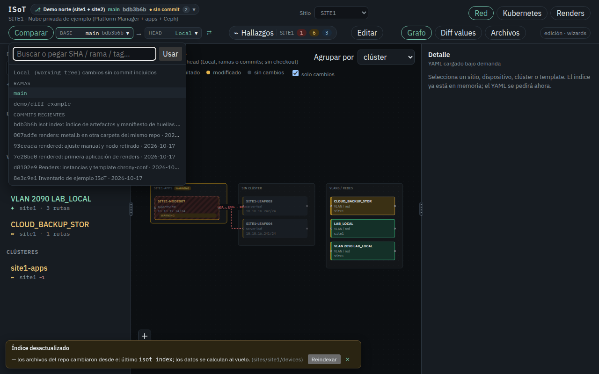
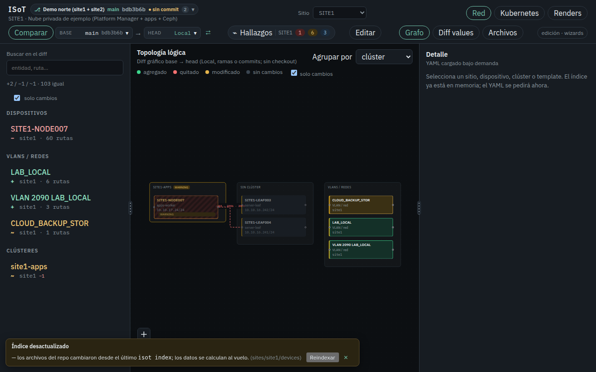
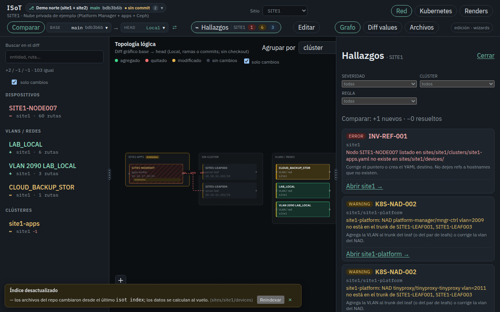
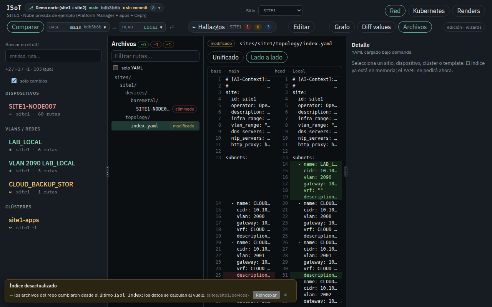
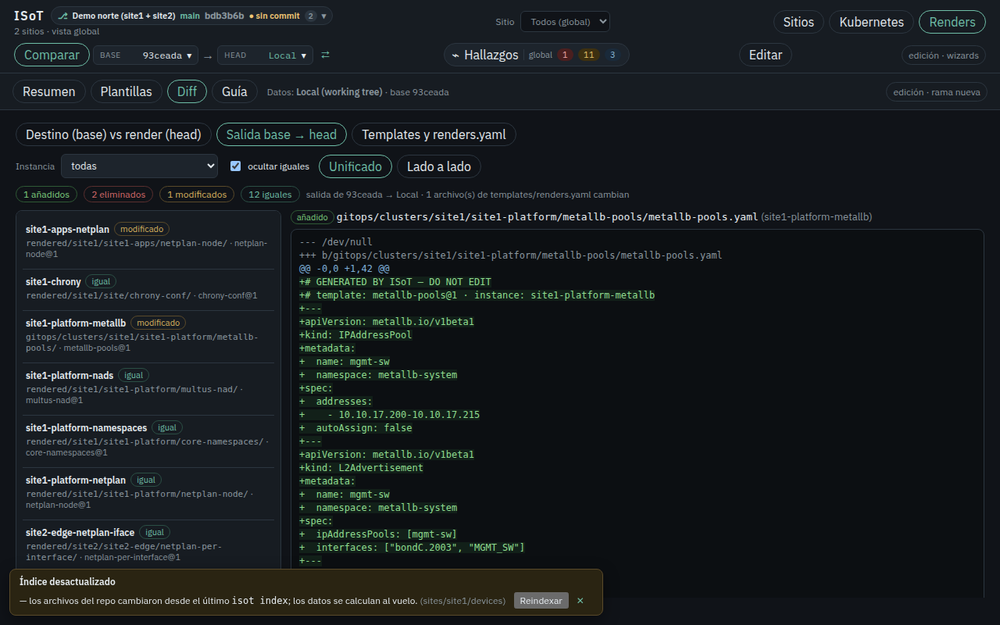

# Comparar: guía de uso

**Comparar** enfrenta dos versiones del **mismo** repositorio de datos y pinta las
diferencias en todas las vistas de ISoT. Cada lado puede ser:

| Lado | Qué es |
|------|--------|
| **Local (working tree)** | Los archivos tal como están en disco, **con** los cambios sin commit y los archivos nuevos no ignorados |
| Rama | `main`, `wizard/…`, `ingest/…`, remotas `origin/…` |
| Tag | `v1.2`, … |
| Commit | SHA completo o corto (`a1b2c3d`), o una expresión `HEAD~3`, `main~1` |

**Head** es lo que estás mirando; **base** es contra lo que se compara. Los
colores siempre leen «de base a head»: verde = aparece en head, rojo = ya no
está en head, amarillo = cambia, gris = igual.

## El control

Arriba, en la barra, junto a la campana de hallazgos:

```
[Comparar]  BASE main ▾  →  HEAD Local 3✎ ▾  ⇄
```

- **Comparar** activa o desactiva el modo (y lo quita de la URL).
- Cada lado abre un menú con buscador: **Local**, ramas, tags y commits
  recientes (SHA corto, mensaje y fecha). También puedes **pegar un SHA**, una
  rama o un tag y pulsar **Usar**: el servidor lo valida con
  `git rev-parse --verify` y avisa si no existe.
- `3✎` indica cuántos archivos tiene el working tree sin commit.
- **⇄** intercambia base y head.
- Por defecto se compara **main (o master) → Local**: «qué cambié y aún no
  está en main».



*Menú de un lado: buscar o pegar un SHA, Local, ramas y commits recientes.*

El estado vive en la URL: `?base=main&head=local` (también con
`&tab=renders&sub=diff`, `?repo=…`). El enlace se puede compartir y se
conserva al cambiar de pestaña.

## Qué se compara en cada vista

| Vista | Qué muestra |
|-------|-------------|
| **Sitios / Red / Kubernetes (grafo)** | Devices, clústeres, templates, releases, enlaces y VLANs coloreados; lo quitado como fantasma (borde rojo punteado). Un sitio o clúster con hijos cambiados queda amarillo con `+N −N ~N` |
| **Detalle de una arista** | Estado del enlace en el diff y los atributos que cambiaron (puertos, VLANs, velocidad…) |
| **Lista lateral y detalle** | Inventario de base → head con «solo cambios»; el detalle de un device/clúster/template lista cada ruta cambiada y ofrece **Ver diff del YAML** |
| **IPAM** | VLANs, subredes por sitio y espacios de direcciones globales (`sites.yaml`) |
| **Diff values** | Values Helm resueltos por clúster y release, base → head |
| **Archivos** | Todos los archivos que cambian (añadidos, eliminados, modificados), con diff **Unificado** o **Lado a lado**; filtro por ruta y «solo YAML» |
| **Hallazgos** (campana) | Las reglas evaluadas en head, con **nuevos** (aparecen en head) y **resueltos** (estaban en base) |
| **Renders → Resumen / Plantillas** | Se leen en **head** |
| **Renders → Diff** | Tres modos: **Destino (base) vs render (head)**, **Salida base → head** (lo que renderiza cada lado) y **Templates y renders.yaml** |



*main → Local en SITE1: un device borrado sin commit (fantasma rojo), una VLAN y
una subred nuevas (verde) y una subred modificada (amarillo). El aviso de
abajo indica que el índice está desactualizado y se calcula al vuelo.*



*Hallazgos: el device borrado deja una referencia rota (INV-REF-001, nuevo).*



*Archivos: el YAML de topología de SITE1, main a la izquierda y Local a la derecha.*



*Renders → Diff → Salida base → head: qué renderiza un commit anterior frente a Local.*

## Ejemplos

- *¿Qué toqué en local?* — base `main`, head `Local`.
- *¿Qué trae la rama del wizard?* — base `main`, head `wizard/…`. Tras un
  commit del wizard, «Comparar» se abre así solo.
- *¿Qué cambió entre dos commits?* — base `a1b2c3d`, head `HEAD`.
- *¿Mi working tree deshace algo de una rama?* — base `wizard/…`, head
  `Local` (o ⇄).
- *Tras «Aplicar» en Renders* — base = la rama nueva, head = Local: el destino
  debería verse en sync.

## Escritura

Comparar es **solo lectura**: no hace checkout, no toca el working tree ni
escribe entre repositorios. Los commits (wizards, Renders, Reindexar) parten
del working tree; en Renders solo se puede escribir con head = **Local** (o
continuando una rama `wizard/…`).

## Límites

- Solo refs del **mismo** repositorio (no se comparan dos repos distintos).
- Las plantillas de la biblioteca de ISoT (`templates/` de la herramienta) son
  iguales en ambos lados: no forman parte del diff; sí las copias del repo de
  datos.
- Archivos binarios: se listan pero sin diff de texto. Archivos de más de
  1 MB no se muestran.
- La ingesta (`_ingest/`) se compara como archivos, no tiene vista propia.

## Índices y Comparar

Cada lado usa **su propio índice**: si el commit trae índices al día
(`_index_manifest.json` coincide con sus fuentes) se reutilizan; si no, se
recalculan en memoria. Los árboles de commits se extraen con `git archive` a
un directorio temporal fuera de ISoT, cacheado por SHA y borrado al salir.
Ver [índice](../../README.md#índice-del-repo-de-datos).
