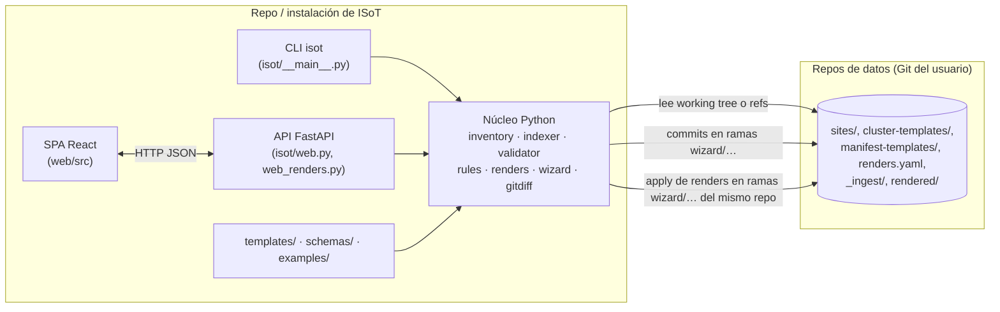

# Arquitectura de ISoT

ISoT (*Infrastructure Source of Truth*) es una herramienta **local**: un
visor/editor web y una CLI sobre uno o varios repositorios Git de datos que
el usuario ya tiene clonados («Git-as-a-Database»). El repositorio de ISoT
contiene solo código, plantillas genéricas, schemas y ejemplos ficticios.

## Vista general

## Piezas

### Núcleo de inventario
- `isot/inventory.py` carga perezosa de sitios, equipos, clústeres y
  cluster-templates (YAML). `isot/indexer.py` genera índices ligeros
  deterministas (`_sites_index.json`, `_device_index.json`,
  `_cluster_index.json`, `_template_index.json`, `_artifacts_index.json` con
  `manifest-templates/`, `renders.yaml`, `rendered/` y `_ingest/`) que la UI
  lee al arrancar; el YAML completo se abre bajo demanda.
- **Frescura del índice.** `_index_manifest.json` guarda la huella (sha256 de
  rutas y contenidos) de cada grupo de fuentes (`sites.yaml`, devices y
  clústeres por sitio, cluster-templates, `manifest-templates/`,
  `renders.yaml`, cada carpeta de salida, `_ingest/`). `index_status`
  compara huellas (con caché de hashes por tamaño/mtime) y `IndexBuilder`
  reutiliza del disco los índices de los grupos sin cambios: reindexar es
  **incremental**. Si el índice está desfasado la API sirve un overlay en
  memoria (`live_indexes`) y la UI muestra el aviso; nunca escribe en el
  working tree por su cuenta (lo dejaría sucio y bloquearía los wizards).
  Todas las escrituras (`wizard.commit_preview`, `renders.commit_files`,
  Reindexar) llaman a `write_indexes` antes del commit. La regla IDX-001 y
  `indexer --check` (CI) detectan índices commiteados desfasados.
- `isot/validator.py` integra integridad referencial, IPAM, cableado y
  reglas; `isot/schemas.py` genera los JSON Schema de `schemas/` **desde el
  código** (y `--check` verifica que estén al día).
- `isot/helm.py` resuelve charts/values de cluster-templates (lazy) y el diff
  values de clúster vs template. `isot/links.py` calcula el detalle de una
  conexión (arista). `isot/cabling.py` y `isot/allocator.py` son la política
  de cableado y la asignación determinista de IPs/hostnames/puertos.

### Motor de reglas (`isot/rules/`)
Registro declarativo: cada regla es una función decorada con
`@rule(id, severity, description, entity, recommendation)` que recibe un
`RuleContext` (snapshot del inventario) y emite `Finding`s. `evaluate.py`
importa los módulos de reglas, aplica overrides de severidad
(`overrides.py`), añade remediaciones legibles por máquina
(`remediation.py`) y agrupa por sitio. Las mismas reglas corren en la UI
(campana de hallazgos), en el validador y en la CI del repo de datos.
Catálogo: [docs/rules.md](../rules.md).

### Renders (`isot/renders.py`, `isot/web_renders.py`, `isot/rules/renders.py`)
Templates Jinja2 (`template.yaml` + `*.j2`) sobre un **contexto versionado**
derivado del inventario (`ContextBuilder`, `context_version: 1`, esquema en
`schemas/render-context.schema.json`). `RenderService` resuelve instancias
(`renders.yaml`) y su carpeta destino (`target_dir`), renderiza en memoria,
compara contra la carpeta destino (`target_diff`) y prepara el «apply»
(`apply_plan` + `commit_files`). Guías: [docs/renders/GUIDE.md](../renders/GUIDE.md),
[docs/llm/RENDERS.md](../llm/RENDERS.md). Principio: **un render vive en un
solo repo**; la carpeta destino es siempre una carpeta del mismo repo de datos
y ISoT nunca escribe de un repositorio a otro.

### Edición (`isot/wizard.py`)
Los wizards (nuevo equipo, nuevo sitio, arreglar un hallazgo) y las
escrituras de renders calculan un **preview en memoria** (diff + grafo +
hallazgos nuevos) y, al confirmar, hacen commit en una rama nueva
`wizard/<slug>` (o continúan una rama `wizard/…`), vuelven a la rama
original y nunca tocan ramas protegidas. El push es opcional
(`edit.push`), solo de ramas `wizard/`.

### Git y Comparar (`isot/refs.py`, `isot/gitdiff.py`, `isot/compare.py`)
Todo Comparar usa base/head donde cualquiera puede ser `local` (working
tree). `refs.py` resuelve refs (`parse_ref` → `git rev-parse --verify
--end-of-options <ref>^{commit}`, siempre con lista de argumentos, sin shell)
a un `RefSpec`; `local` lleva una huella del working tree (HEAD + rutas,
tamaños y mtimes) como clave de caché. `TreeCache` materializa commits con
`git archive` en un `mkdtemp` **fuera** de ISoT y del repo, cacheado por SHA
(LRU con refcount, borrado con `atexit`); `tree_for` da el propio repo para
`local`. Sobre eso: `gitdiff.semantic_diff` (snapshots por ref que reutilizan
el índice commiteado de esa ref si está al día; entidades con `path` del
YAML de origen), `evaluate_ref`/`diff_findings` (hallazgos nuevos/resueltos),
`links.diff_details` (aristas), `compare.changed_files`/`file_diff`
(archivos, con no rastreados en `local`) y `renders.compare_outputs` (salida
renderizada base → head). Todo es de solo lectura.

### Configuración y multi-repo (`isot/config.py`, `isot/web.py`)
`isot.yaml` declara `repos` (id, path, branch, edit…), `default_repo`,
`edit` y `ui`. En la API,
`RepoRegistry` mantiene los repos y `RepoPrefixMiddleware` reescribe
`/api/repos/{id}/…` a `/api/…` con el repo elegido; sin prefijo se usa el
repo por defecto. Cada repo es una fuente de verdad independiente.

### Ingesta (`isot/ingest.py`, `isot/rules/ingest.py`, `docs/llm/INGEST.md`)
ISoT no llama a LLMs: define el formato, `_ingest/` (state, provenance, gaps)
y comprobaciones (`isot ingest status|hash|check`, reglas ING-*) para que un
agente externo construya o actualice el repo de datos.

### Frontend (`web/`)
React 18 + TypeScript + Vite + @xyflow/react. `Root.tsx` resuelve la
configuración/repo y monta `App.tsx`, que orquesta las vistas (Sitios/Red,
Kubernetes, Renders, Editar) y el control único `CompareControl` (base →
head, estado en `?base=&head=` vía `compare.ts`, compartido por grafo,
listas, detalle, Archivos, hallazgos y Renders), los paneles redimensionables
(`Splitter`), el panel de hallazgos y el detalle. La lógica pura vive en
módulos `*.ts` sin React (testeados con `node --test`); los componentes en
`components/`. Todas las llamadas pasan por `api.ts`/`rendersApi.ts`, que
añaden el prefijo `/api/repos/{id}`.

## Flujo de datos

1. **Lectura**: la UI pide índices (`/api/sites`, `/api/sites/{id}/devices`…)
   y grafos; el backend lee el working tree del repo de datos (o un ref
   materializado). Detalles, values y contexto de render se cargan al
   seleccionar.
2. **Reglas**: `load_context(root)` → `evaluate()` → hallazgos por sitio,
   con remediaciones que la UI convierte en acciones («abrir», «arreglar con
   wizard»).
3. **Edición**: formulario → `POST …/preview` (sin escribir) → diff y
   hallazgos nuevos → `POST …/commit` → rama `wizard/…` → revisión y merge
   en el repo de datos (PR/MR, CI con el workflow reutilizable).
4. **Renders**: template + instancia + contexto → archivos en memoria →
   diff contra la carpeta destino del mismo repo → «aplicar» en una rama
   `wizard/…` de ese mismo repo.

## Por qué está diseñado así

- **Datos fuera de ISoT.** El inventario vive en repos de datos con sus
  propios permisos, revisiones y CI. ISoT no tiene usuarios ni roles: usa la
  identidad git del usuario. Así ISoT puede ser público y genérico, y el
  control de acceso se **delega en el repo de datos** (ramas protegidas,
  CODEOWNERS, CI).
- **Solo plantillas genéricas en ISoT.** `templates/` (sitios,
  cluster-templates, renders) es una biblioteca de solo lectura; personalizar
  = clonar al repo de datos. Toda salida renderizada va al mismo repo de
  datos, nunca a otro repositorio ni a la instalación de ISoT (se rechaza por código y
  hay tests de ello). Esto evita mezclar datos de clientes con la
  herramienta.
- **Edición vía ramas.** Nada escribe en `main`: los wizards y renders
  proponen ramas `wizard/…` que una persona revisa. El árbol debe estar
  limpio y se vuelve a la rama original tras el commit.
- **Render determinista y en sandbox.** Jinja2 `SandboxedEnvironment` +
  `StrictUndefined`: un template no puede ejecutar código ni leer archivos,
  y una variable inexistente es un error con archivo:línea en lugar de una
  salida vacía silenciosa. El contexto está versionado y documentado; los
  secretos se redactan antes de llegar al template y la salida se escanea.
  El mismo input produce el mismo output (rutas ordenadas, saltos de línea
  normalizados), así el diff contra el destino es fiable.
- **Índices ligeros + carga perezosa.** Repos grandes abren rápido; los
  índices son deterministas y se verifican en CI (`--check`).
- **Schemas desde el código.** Una sola fuente de verdad del formato; CI
  falla si `schemas/` no está regenerado.
- **Repo público, anonimizado.** Los ejemplos son ficticios; `isot
  leakcheck` busca identificadores prohibidos guardados como **hashes**
  (`isot/forbidden_patterns.json`) para no publicar los términos en claro;
  los commits se firman con el email *noreply* del autor.
- **Lógica pura separada de la UI.** Cada comportamiento no trivial del
  frontend (URLs, layout, hallazgos, diff, árboles) es una función pura con
  tests rápidos sin navegador.
